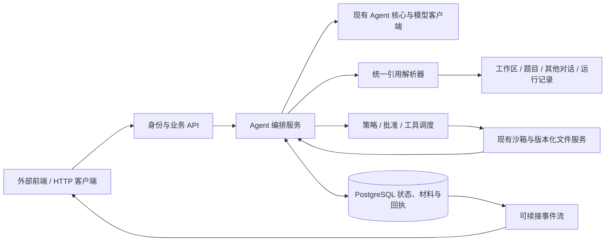

# Agent 上下游全流程接入计划

状态：2026-11-06 用户确认总体范围，并明确引用与查询阅读分开、本分支只做后端。按批实现，检查确认后提交。
用户已确认包含主动/被动压缩、文件阅读管理与跨对话阅读的 [上下文管理设计](agent-context-management-plan.md)。
[第一批持久化底座](agent-integration-stage1.md) 已确认并提交 `add28b6`；
[第二批引用与阅读](agent-integration-stage2.md) 已确认并提交 `a892a67`，未推送。
[第三批 A 上下文原子能力](agent-integration-stage3a.md) 已确认并提交 `925802e`，未推送。
[第三批 B 持久只读运行](agent-integration-stage3b.md) 已确认并提交 `236967e`，未推送。
[第四批 A 命令执行](agent-integration-stage4a.md) 已确认并提交 `7248d51`，未推送。
[第四批 B 版本化单文件修改](agent-integration-stage4b.md) 已确认，本地提交，未推送。
分支：`feat/agent-integration`，基于已验收的 `feat/llm-api@8c25e65`。
旧分支的 Agent 核心尚未进入 main；新分支保留该依赖，后续先合入核心再整理集成 PR 的基线。
本计划依据现有代码整理，其他 Agent 生成的计划只作为参考，不自动成为任务要求。

## 1. 分支目标与完成标准

本分支负责把 Agent 原子库接入真实业务，贯通：

考生身份 → 考试会话 → 多条 Agent 对话 → 用户输入/引用 → 模型 → 读取或操作请求 →
策略判断/必要批准 → 真实沙箱 → 结果回传 → 模型续调 → 对外响应/事件 → 持久记录与恢复。

完成后，不依赖前端实现，HTTP/事件客户端即可跑通整条后端链路；记录可追溯到用户输入、
实际引用版本、模型请求、工具调用、执行结果和最终回答。
一个 Turn 可以在配置预算内自动继续读取和调用模型；等待批准、完成、失败、中断或到期时停止。
目标是两个分支组合后完整承接编程 Agent 的后端运行；除联网搜索外按上游能力表逐项复现和验收。
不直接调用 Codex/Claude SDK 或 CLI 来代替实现，也不宣称与两款产品的未公开内部实现完全相同。
上游对照与扩展能力清单见 [能力矩阵](agent-upstream-capabilities.md)。本分支不修改 frontend/。

继续复用 app.agent 的 Conversation/Turn/ModelStep，不另建一套会话状态机。
新业务编排放在 app.agent_integration，核心层继续接受显式输入，不依赖 FastAPI、数据库或 Docker。
实际沙箱操作扩展现有 app.sandbox；文件读写继续复用 app.workspace。

已核对上一分支：全局 prompt、ToolDefinition/ToolRegistry、原生调用解析与 ToolResult 配对
均属于 `app.agent`，读取和执行共用同一协议。本分支只注册真实处理器、策略与持久化，
不新建一套模型返回格式；协议若确有缺口，应修补核心后再由集成层使用。

## 2. 会话、考试与沙箱的关系

- ExamSession 是考试归属、截止时间、沙箱绑定与交卷门禁的现有业务单位。
- 一个 ExamSession 可以有多条 Agent Conversation；每条 Conversation 同时只有一个活动 Turn。
- Turn 是 Agent 一次运行的业务单位，ModelStep 是其中一次模型调用。
- 调度租约、批准和执行回执关联已有 turn_id/step_id，不新增并列的活动/任务层级。
- 多个 Conversation 可以引用同一工作区，但修改型操作按同一个 ExamSession/沙箱协调，不能各自无约束运行。
- 默认只允许当前考生本次考试的对话互读，以及题目明确开放的历史；其他来源由服务端策略提供。

对外显式区分 exam_session_id 与 conversation_id，避免都叫 session。
scope_id 由服务端根据原考生 Cookie 和考试归属构建；模型、浏览器和工具参数不能自行扩大范围。
题目版本与沙箱 ID 从现有绑定读取，不让模型或前端传入任意容器、宿主路径或镜像。

## 3. 现有基础与接入缺口

| 已有能力 | 新分支补齐 |
| --- | --- |
| app.agent 会话、原生工具交互、压缩和快照 | 真实业务服务、持久存储、任务恢复与上游接口 |
| require_candidate_session 考生身份与会话归属 | Agent 路由复用原 Cookie、来源检查和业务权限 |
| ExamSession、SessionLifecycle、write_guard | Agent 与截止、交卷、冻结和清理的联动 |
| WorkspaceReader.read/tree/save 与文件版本表 | 引用适配、选区版本对齐和受控文件修改 |
| SandboxRuntime 文件操作、DockerTerminalFactory PTY | 带独立执行 ID、输出、退出状态、超时和取消的命令接口 |
| 当前工作台编辑器、文件树、保存队列和终端 | 提供引用、批准、进度、输出和恢复的后端协议与联调客户端；不开发页面 |

当前文件策略是题目发布清单，并非任意代码库浏览器；扩展题目/依赖来源时要增加受控来源适配，
不能通过放宽现有路径检查绕过发布边界。当前 read/tree 还要求考试可写状态，
交卷后的历史查看应读取已保存材料或答卷快照，不能强行复用活跃工作区读取。

## 4. 引用输入与主动查询阅读：两套入口和语义

用户引用是输入能力：附加文件/目录/代码段/会话等定位信息，或者显式提供选区、未保存内容。
定位引用不等于已经读取正文，不自动把目录和整库全量注入模型。
用户明确提供的文本材料可进入本轮输入，不伪造模型工具请求。

Agent 查询阅读是独立的原子工具能力：list_directory、glob_paths、search_content、read_file、
read_range、read_conversation、read_execution_output 等。它可以探索整个授权工作区，
不要求用户先引用目标；查询命中不等于正文已经读取，阅读结果通过真实 tool call/result 回传。

两者可以复用底层来源适配和不可变材料存储，但请求类型、权限判断、触发原因和记录分开。
原始用户文字、附加引用、主动查询和实际读取到的材料分别记录。
文件阅读记录、源内容版本、材料快照与当前模型可见内容独立管理；具体见上下文设计。

### 4.1 首轮覆盖的来源

| 来源 | 对齐信息 |
| --- | --- |
| 沙箱文件、文件行区间、指定代码段 | workspace/path、文件版本、内容摘要、实际范围 |
| 编辑器选区、未保存缓冲区 | path、base_version、缓冲区摘要、选区；明确标注尚未落盘 |
| 当前代码库的目录、搜索、多个文件 | 工作区/题目版本、目录或命中范围、逐文件版本；目录不代表已读正文 |
| 指定依赖库 | 服务端注册的来源、包/库版本、允许读取的目录或文档 |
| 题目说明、发布材料、示例 | task_version_id、材料标识、版本和实际区间 |
| 另一 Agent 会话、指定消息/轮次 | 源 conversation_id、源 revision、稳定 turn/step/message 标识和分页边界 |
| 题目自带的对话历史 | 发布版本、可信来源标识、历史消息范围；作为材料而非实时用户指令 |
| 命令输出、测试结果、错误信息 | execution_id、输出片段、完整性与退出状态；普通 stdout 不作为可信评分结果 |
| diff/补丁 | 基础文件版本、变更范围；引用补丁与批准应用补丁分开 |
| 文本附件 | 内容类型、上传主体、不可变内容摘要和提取结果 |

“所有引用”以工作台来源和明确注册的适配器为边界。二进制/图片等未实现内容类型返回明确不支持，
不静默忽略；任意外网 URL 或宿主机目录不自动成为读取能力。

### 4.2 统一契约

建议区分 InputReference（用户引用）、WorkspaceQuery/ReadRequest（Agent 查询/阅读）与 MaterialSnapshot（不可变材料）：

- 定位：kind、source_id、selector、期望版本；具体来源有自己的参数校验。
- 取材结果：material_id、来源归属、实际版本、实际范围、内容摘要、内容或存储指针。
- 状态：成功、过期、不可用、拒绝、截断；包含 has_more/后续游标与读取时间。
- 关联：所属 conversation/turn，以及来源为用户附加、查询命中还是实际工具阅读；保留真实 tool_call_id。

文件行号与字符区间分别定义；Monaco 的 UTF-16 列与后端 UTF-8 字节偏移显式转换，
选区绑定具体内容摘要，并覆盖中文、emoji、CRLF 和跨行范围测试。
旧版本行号不能直接套到新文件；能提供旧材料就按旧材料返回，否则明确提示引用过期。
未保存缓冲区可以供模型分析，但执行命令使用实际沙箱内容，不能冒充已保存文件。

所有来源先鉴权、再取材、再记录实际版本；历史中的提示文字不会提升为系统指令。
跨会话读取返回被选取的消息数据，不合并两条对话的状态、系统提示或供应商续调字段。
目录/搜索/消息范围均有分页和尺寸上限，明确区分索引、正文与摘要。

历史取材记录按 Turn/步骤累计，当前模型窗口另外维护：
每次模型准备产物记录实际包含的材料与摘要检查点，压缩后不把“以前读过”误认为“正文仍在窗口”。
不额外实现跨版本阅读覆盖率或自动推断模型已经掌握了哪些代码。

## 5. 数据库与运行恢复

复用现有 PostgreSQL、SQLAlchemy、Alembic 和 ExamSession 外键，不再建立另一套考生/考试身份表。
建议按以下职责分表，具体列和约束在第一批固定：

| 记录 | 主要职责 |
| --- | --- |
| agent_conversations | 考试归属、标题、revision、核心 state_json、配置版本；实现 PostgresSessionStore |
| agent_turn_executions | turn_id 对应的策略快照、预算、调度租约、等待原因及运行时间 |
| agent_model_calls | 步骤/压缩请求、脱敏准备产物、响应、结束原因、用量和调用状态；包含未采用和迟到结果 |
| agent_tool_invocations | 工具参数、操作 ID、批准记录、执行状态、回执和幂等关联 |
| agent_reference_materials | 不可变引用定位、版本、范围、摘要和实际材料 |
| 阅读与上下文记录 | 实际阅读的文件/消息范围、材料关联、压缩检查点及每次请求的窗口清单 |
| agent_interactions | 等待批准/用户补充信息的请求、参数摘要、答复和解决状态 |
| agent_events | 按会话递增的事件及待投递记录，供页面续接和审计 |

首版会话核心 state_json 是唯一可修改的 Agent 会话状态；其他表记录不可变材料、外部尝试与业务回执，
不再维护另一份可独立编辑的 messages。页面历史和考官查询从这些记录生成视图。

状态转换、CAS revision、关联回执和可见事件尽量在同一个短事务中提交。
模型网络请求和长命令不持有数据库行锁：先提交预留记录，再调用外部系统，再按版本确认结果。
执行与数据库不可能组成一个事务，按“持久预留 → 调度 → 查询实际回执 → 接受结果”处理恢复间隙。
执行结果不明时标记 unknown，禁止通过自动重跑来猜测或补齐结果。

普通数据库加载不能调用会中断活动 Turn 的 restore_snapshot。
上下文压缩必须同时覆盖主动请求与按预算自动触发，支持活动 Turn 内已完成交换的安全压缩；不局限于结束整个 Turn 后再操作。
恢复时区分：未调度、已调度、等批准、已知运行、已结束待回填、结果未知。
有稳定 execution_id 的工具先查询/接回原执行；模型请求已发出但响应遗失时，不默认重发。
同会话 worker 用租约和 CAS 协调；多会话对同沙箱的修改型请求也要在考试维度协调。

用量记录覆盖实际发起的步骤和压缩尝试，迟到或未采用响应也能核对；没有供应商回执的费用仍标为未知。
API Key、鉴权头不进入数据库请求产物、事件流或沙箱；供应商续调元数据不作为用户可见推理展示。

## 6. 真实沙箱操作与反馈

### 6.1 工具与运行策略

本分支交付真实的读取工具、run_command、受版本保护的文件修改/补丁工具和执行状态查询/取消。
读取/查询原子接口也可独立调用；进入 Agent 工具调度时统一经过策略评估，而不是仅命令需要判断。
补丁复用现有安全保存；逐文件核对 expected_version/摘要，只读文件仍不可写。
多文件操作必须返回逐文件真实结果，不把部分成功包装成数据库与文件系统的整体原子事务。

建议运行模式：

| 模式 | 行为 |
| --- | --- |
| chat_only | 仅对话及用户显式提供的材料，无模型自主工具调用 |
| read_only | 自动读取已授权来源，不执行命令或修改文件 |
| confirm_actions | 自动读取；命令和修改先持久化请求，批准后才执行 |
| sandbox_auto | 场次显式允许时，受预算限制地自动执行允许的沙箱操作 |

未启用 AI 的旧场次保持禁用；新场次先以 read_only 接通验证。
模式、允许来源和预算来自服务端场次/题目配置，并在每轮固化策略版本。
批准绑定具体参数摘要、目标沙箱、文件版本、策略版本与到期时间；参数或目标变化需要重新批准。
谁可批准由场次策略确定，前端不能靠提交 approved=true 自行取得能力。

每次操作显式给出 policy_decision=allow/ask/deny，分别表示直接执行、等待批准或拒绝。
这与实际运行状态分开：requested、waiting_approval、queued、running、succeeded、failed、
denied、cancelled、timed_out、unknown。查询/阅读同样向客户端暴露决策及原因。
等待补充信息使用 waiting_user_input，不能与批准操作混为一类。
事件和查询响应携带 operation_id、conversation_id、turn_id、step_id、tool_call_id、
工具名、允许展示的参数、reason_code、approval_id/到期时间以及结果完整性。

### 6.2 命令回执

新增独立非交互执行适配器，不向浏览器的 PTY 填命令来猜测结果。
操作在已经绑定的 gVisor 沙箱内执行，记录 cwd、argv/明确的 shell 模式、超时和输出限额。
不在 API 宿主机执行候选人命令，也不向容器注入模型 Key。

回执至少包括：execution_id、运行/结束状态、stdout/stderr、exit_code、耗时、超时/取消原因、
输出是否完整/截断、可选文件变化信息，以及实际开始和结束时间。
输出片段先记录，再向页面推送；完整回执转成 ToolResult 后才继续模型步骤。
非零退出不等于协议失败，退出 0 也不能仅凭某段 stdout 宣称所有任务成功。

超时要处理实际沙箱进程，不能仅停止 HTTP 等待；取消、进程结束和回执持久化分别记录。
进程重启后若无法取得完整输出，保留已有片段并标明缺失，不通过重跑命令恢复输出。
浏览器断开不自动取消运行；用户明确中断与考试到期触发取消/停止续调。

交卷/到期优先关闭新操作入口，冻结沿用已有沙箱生命周期。
不得为了取消 Agent 命令而恢复已经冻结的考试环境；无法确认的执行结果保持未知。
多会话修改请求统一协调，但不宣称排队能阻止已有人工终端后台进程写文件，
文件修改仍须在实际写入前重新校验版本和摘要。

## 7. 上游 HTTP、事件与前端交接

路由建议挂在 `/api/v1/sessions/{exam_session_id}/agent`，复用原考生鉴权和来源检查。
对上游至少提供：

- 创建、列出、读取 Agent 会话和分页历史。
- 提交用户输入、引用与固定 request_key，返回 turn_id 和当前状态。
- 查看/预览引用解析结果与模型实际输入的允许展示部分。
- 订阅可续接的会话事件，查看工具请求、批准状态、执行输出和最终回答。
- 批准/拒绝指定工具操作，中断 Turn，查询/取消原 execution_id。
- 获取并回答 Agent 的补充问题、查看计划进度；补充回答与批准答复分别处理。
- 显式压缩和恢复查询；考官按现有权限只读调阅关联记录。

浏览器只提交新输入、引用、批准/拒绝和中断意图，不直接提交模型响应、工具执行成功回执或整份会话覆盖。
accept_response/supply_tool_results 由可信服务端编排器调用；未来外部执行器的回调也需要独立鉴权和操作 ID 校验。

优先提供带游标的 SSE 事件及普通 HTTP 查询，先以既有非流式模型接口形成闭环，再补模型增量流。
事件流覆盖文本、工具、批准、提问、命令输出与结束；模型工具参数未完整解析前不能执行。
刷新、切换会话和重连按序号补事件，不重复提交用户输入或重发命令。

本分支提供 HTTP/事件协议、类型定义、示例载荷、错误码和可运行后端客户端，不实现任何面板、组件或编辑器改动。
向前端明确提供未保存材料标识、文件变化及新版本，便于组员接入现有保存队列并保留草稿。
前端只消费后端状态并提交意图，不负责替后端执行工具、猜测退出码或自行继续模型循环。

## 8. 分批实现与每批验收

继续按“实现一批 → 用户检查确认 → 提交 → 下一批”推进。各批均只交付后端。

| 批次 | 交付 | 可检查的结果 |
| --- | --- | --- |
| 1. 上下文契约与持久底座 | 优先固定阅读记录/材料/窗口/压缩边界；引用/策略/操作契约；迁移、PostgresSessionStore、会话基础接口 | 同一考试创建两条对话，进程重启后历史不丢，跨考生拒绝，并发保存不覆盖 |
| 2. 引用与工作区原子服务 | 独立引用输入；目录/文件查找、内容搜索、分段阅读、题目/依赖/会话/运行结果适配 | 用户未引用文件时 Agent 也能查询阅读；版本、范围、越权、分页和不支持类型明确 |
| 3. 只读与上下文闭环 | 有预算的 Turn 编排；阅读材料管理；主动/被动压缩；allow/ask/deny、批准/提问和事件 | 长对话和长 Turn 可压缩后继续，文件与跨会话正文按需要取回，重连恢复状态 |
| 4. 执行与修改 | 真实沙箱命令回执、查询/取消、批准/拒绝、版本化补丁、执行结果续调 | 批准后执行一次；拒绝不执行；失败/超时/冲突明确反馈并正确回到模型 |
| 5. 会话与上下文能力 | 模型流式、引用预览、压缩恢复、会话分叉/重试、变更检查点和只读调阅协议 | 长对话经真实工具交互和压缩后可恢复，分叉不改原记录，文件恢复独立批准 |
| 6. 故障和联合验收 | worker 重启、重复投递、交卷/截止竞争、真实 PostgreSQL 与 Linux/gVisor 端到端 | 外部结果未知不重跑、不越过截止门禁；所有成功/失败均有可核对记录 |

计划进度、项目说明、Skills、Hooks、MCP 与子 Agent 等增强项按上游能力矩阵独立拆批，
复用同一调用、审批和持久化边界，不以预留接口冒充已实现能力。

每批提供接口契约、运行示例和与改动对应的测试。开发期使用模拟客户端和临时数据库，
只有真实模型/数据库/沙箱联合验收通过后，才将全流程标为已接通；跳过的用例不计为通过。

第三批继续拆成两小步验收：A 先扩展长 Turn 压缩边界、材料窗口投影、预算和只读查询；
B 再接持久运行编排、每次模型/压缩尝试与窗口记录、主动/被动触发、批准/提问和自动续调。
A 的阈值规划不标为自动运行闭环已经完成。

第四批也拆为两步：A 交付持久命令、批准、输出取回、取消与未知执行恢复；
B 再交付版本化结构文件修改、补丁与变更回传。命令运行时能修改原任务允许写入的文件，
不等同于独立的文件编辑/补丁审批接口已经完成。

## 9. 最终验收场景

1. 混合引用与 Agent 自主查询阅读分别跑通；用户没有附加文件时，Agent 仍能在授权工作区探索并回答。
2. 中文、emoji、CRLF 选区能复现原片段；未保存片段与已落盘文件不会混淆。
3. 两条对话共享一个沙箱；引用可查到源版本，修改请求受统一协调，旧版本批准不能覆盖新内容。
4. 直接执行、等待批准、拒绝均有可查询事件；正常命令、非零退出、超时、取消、输出截断明确反馈。
5. 重复用户消息、重复批准、重复工具回执不重复执行；事件重连不触发命令重放。
6. 执行后数据库写入失败或 worker 中途退出，能按原执行 ID 核查；结果不明保持 unknown。
7. 等批准和执行期间到期/交卷，不再启动后续操作，不解除提交冻结，不把中断当成功。
8. 上下文压缩后完整材料记录仍可查，重启后恢复正确窗口，实际模型调用和用量可核对。
   主动压缩、阈值自动压缩、明确超限后的有界补救分别验收；活动 Turn 不因压缩而丢失当前任务。
9. 关闭 AI 的场次保持现有行为；AI 场次通过真实 HTTP/事件客户端完成以上流程，无需实现前端。

## 10. 本轮不扩展的范围

本分支不实现前端，也不提供联网搜索工具。任意宿主路径访问、跨考生对话开放、
完整题库管理或权限管理后台不纳入 Agent 后端的复现范围。
Git 的本地查询和操作按工作区工具接入；涉及外部系统或额外联网的操作独立受服务端策略控制。
支持来源以注册适配器为准；新增来源沿用同一定位、鉴权、取材、版本与记录契约。
