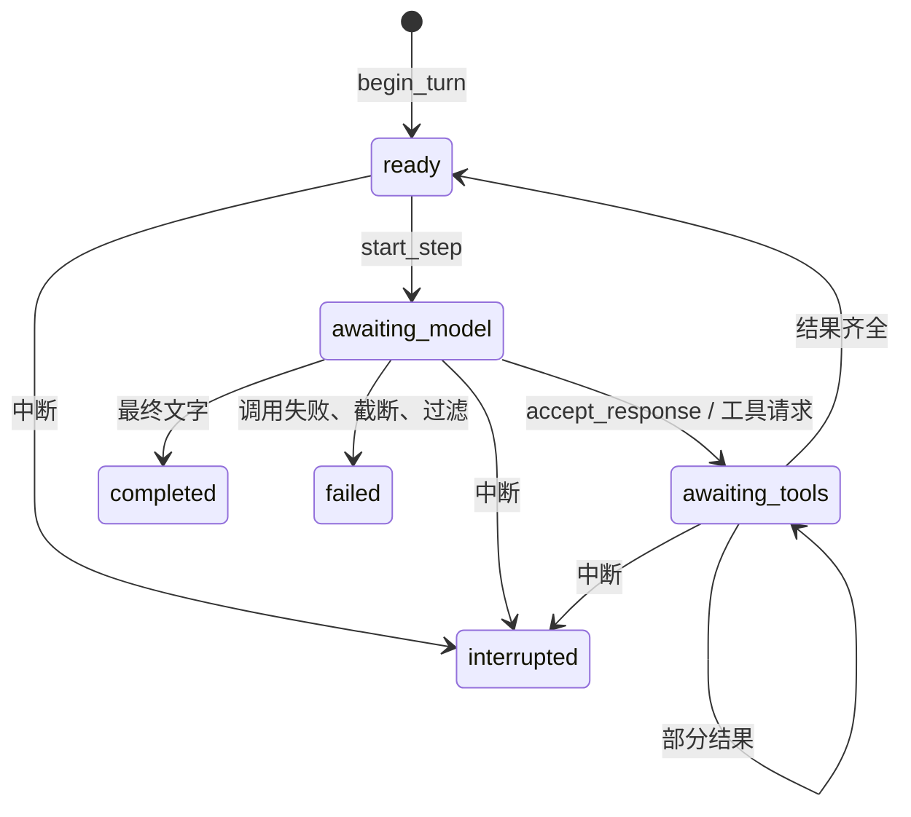

# 第四批：组员接入契约与完整示例

状态：2026-11-05 用户已确认，作为第四批检查点提交。
前三批已确认提交为 ac80abc、abd1a1e、e9e914a，均未推送。

组员从 `backend/examples/agent_handoff.py` 开始接线。示例将现有原子接口组合起来，
演示代码读取、另一会话/题目历史读取、分批结果回传、压缩和恢复后续调。
辅助函数属于示例应用，没有新增核心运行时、执行器或 HTTP 接口。

## 会话由谁维护

服务端用 ConversationState 维护一份完整记录，Turn 表达一次用户输入，ModelStep 表达一次模型调用。
用户界面从记录中选取文字、工具状态和结束状态；API 输入通过 prepare_model_request 从当前窗口生成。
前端只提交新输入及关联 ID，不回传一整份 messages 覆盖服务端记录。

| 标识 | 用途 | 来源与边界 |
| --- | --- | --- |
| scope_id | 存储隔离和归属检查 | 服务端鉴权后提供；模型和浏览器不能自行扩大范围 |
| conversation_id | 一条独立对话 | create_conversation 生成；同一 scope 可以有多条 |
| request_key | 用户输入去重 | 调用方为一次输入固定生成；相同 key 不能对应不同正文 |
| turn_id | 用户轮次 | begin_turn 生成；一轮可以有多个模型步骤 |
| step_id | 单次模型请求及回传关联 | start_step 生成或接收服务端提供的稳定 ID |
| tool_call_id | 一次工具请求与结果关联 | 模型返回；与会话、step_id 一起使用，不能单独作为全局任务 ID |
| revision | 会话并发保存 | 每次有效状态转换加 1；重复相同结果不加，save 使用 expected_revision |

读取会话 A 的内容不会切换当前会话 B，也不将 A 的系统提示、供应商续调字段或状态机合并到 B。
题目附带历史可以是外层维护的来源会话，通过读取工具作为数据返回。
真正恢复本库会话则使用服务端保存的快照，两种用途分开。

## 可调用的 Python 接口

以下函数从 app.agent 导出，除 call_model、call_compaction、chat_only 外均为同步调用。
状态转换返回新对象；调用方负责保存。

| 操作 | 接口与返回值 |
| --- | --- |
| 创建/保存/加载 | create_conversation(scope_id, config=...) → ConversationState；SessionStore.create/load/save |
| 提交一条新输入 | begin_turn(state, text, request_key=...) → ConversationState |
| 预留模型步骤 | start_step(state, step_id=...) → awaiting_model 状态 |
| 查看实际请求 | prepare_model_request(state, tools=..., settings=...) → PreparedModelRequest；payload 是独立字典 |
| 调用一次模型 | await call_model(prepared, tools=..., client=...) → ModelResponse |
| 接受模型输出 | accept_response(state, step_id, response) → 新状态 |
| 暴露待处理工具 | pending_tool_calls(state) → tuple[ToolCall, ...] |
| 外层交回工具结果 | supply_tool_results(state, step_id, results) → 新状态；允许部分结果 |
| 标记调用失败 | fail_step(state, step_id, error_code="MODEL_CALL_FAILED") → failed 状态 |
| 用户中断 | interrupt_turn(state, turn_id) → interrupted 状态 |
| 读取记录/窗口 | render_history(state)、render_context(state) → 原生角色列表；context_info(state) → 尺寸及代数 |
| 压缩 | prepare_compaction → await call_compaction → apply_compaction；详见第三批 |
| 导出/恢复 | state.model_dump_json()；restore_snapshot(json, scope_id=...) → ConversationState |

关键类型所在模块：

- app.agent.session_types：SessionConfig、ConversationState、TurnState、ModelStep、ModelResponse、ToolCall、ToolResult、TokenUsage、ContextCheckpoint。
- app.agent.model：PreparedModelRequest、CompletionClient。
- app.agent.compaction：PreparedCompaction、CompactionResult。
- app.agent.context：ContextInfo。

ModelResponse 返回实际模型、message、finish_reason、usage 和可选 response_id。
message.content 是助手文字，message.tool_calls 是结构化请求，两者可以同时出现。
工具请求非空时不能将助手文字当成整轮结束；以更新后的 Turn.status 为准。
每步用量在 step.response.usage；state.usage 和 state.compaction_usage 是已接受记录的汇总。
message.continuation_json 是适配器续调数据，不能当作可展示的内部推理。

## 外层应遵守的调用顺序



1. 按可信 scope 加载会话，begin_turn 后立即以原 revision 保存。同 request_key 的重复输入返回现状，不能因此再调一次模型。
2. 只在 ready 时 start_step；先准备并校验请求，再以 CAS 保存 awaiting_model 状态，保存成功才发送。
3. call_model 返回后重新加载会话，按 step_id 接受结果并以 CAS 保存。不要将结果套回网络请求前的旧快照。
4. awaiting_tools 时将调用 ID、名称、已校验参数交给外层；外层重新检查目标资源归属，并返回 ToolResult。
5. 每一批结果单独保存。全部齐全后状态变为 ready，由上层显式决定是否再调用一步。

`examples.agent_handoff.run_one_step()` 给出了存储与客户端注入的接线代码：
校验 → CAS 预留 → 一次模型调用 → 重新加载 → 接受/失败 → CAS 保存。
它没有循环，也不处理工具；不要把它当作已经接入部署的调度服务。
独立线程/进程接入时，SessionStore.save 必须真正原子地比较 revision 并更新，不能实现成无锁的先读后写。

每个转换必须分别保存：begin_turn 和 start_step 各增加一次 revision，不能只将两个转换的最终状态保存一次。
并发 CAS 失败时重新加载并返回当前状态/冲突，不盲目覆盖或自动重发模型请求。
网络已发出后的中断不代表供应商请求被取消，仍可能产生用量；本库没有外部调用 exactly-once 保证。

## 工具输入与历史读取

ToolRegistry 只持有工具名称、说明和 Pydantic 参数模型，不持有执行函数。
参数模型设置 ConfigDict(extra="forbid")；用 registry.parse_arguments(call) 获取严格校验后的对象。
普通对话使用空 ToolRegistry。相同会话的 prompt/tools 版本必须匹配，每次发送前校验工具定义指纹。

本示例只声明 read_file 和 read_conversation。下表是其他组员可自行声明的工具形状，不是新增的默认工具或统一资源库：

| 读取用途 | 参数示例 | 外层结果应说明的范围 |
| --- | --- | --- |
| 指定文件 | path | 路径、读取时版本和正文；超长时明确分段 |
| 指定代码段 | path、start_line、end_line | 实际行范围、版本、正文及是否截断 |
| 指定代码库 | repository_id、query/path | 库标识和版本、目录/搜索结果；索引不代表所有文件正文已读 |
| 另一会话 | conversation_id、first_turn、max_turns | 源 revision、实际 turn_id、messages、是否还有后续 |
| 题目附带历史 | problem_id 或服务端映射的 conversation_id | 历史来源、版本、选取范围和正文 |

工具参数不接受模型自报的 scope 或权限。路径范围、库映射、可读取会话集合由外层从可信身份确定。
示例 read_conversation_result 先检查可读取集合，再按可信 scope 加载源会话；未授权与不可用统一返回 SOURCE_UNAVAILABLE。
来源 revision 是这次读取的快照，不意味着后续源内容固定不变。
示例 first_turn 从 1 开始，max_turns 最多 5；空范围返回空 messages，has_more 为 false。
真实读取器还需控制单次正文尺寸，超过 ToolResult 的 64000 字符上限时明确分段或报错。

源会话的 user/assistant/tool 消息被序列化在一条 ToolResult.content 中，作为历史材料交给当前模型。
不要将这些消息直接拼入当前顶层 messages，也不要将读取结果放入 SessionConfig.system_prompt。
读取器可以返回 JSON 字符串，格式由具体工具约定；模型调用层不需要认识每一种来源类型。

拒绝、失败和缺失可以返回 ToolResult(tool_call_id=..., content="SOURCE_UNAVAILABLE", is_error=True)。
它会作为明确错误回传模型，不自动使整个 Turn 失败；外层仍决定何时继续。
本批没有审批队列或执行权限状态；将来命令/改代码也可以使用同样的请求与结果边界，由外层实现。

## 注入接口与错误处理

| 边界 | 接入要求 |
| --- | --- |
| CompletionClient | async complete(payload: dict) → dict；接收已准备的非流式 Chat Completions 请求，返回供应商响应；LLMClient 是默认实现 |
| SessionStore | 同步 create(state)、load(scope_id, conversation_id)、save(state, expected_revision=...)；默认 MemorySessionStore 是进程内存 |
| 工具结果端口 | 接收当前会话/步骤的 ToolCall；外层校验范围、读取或拒绝，再返回匹配 ID 的 ToolResult；核心库不调用 handler |

客户端不拥有会话、沙箱或权限。鉴权头和 Key 留在客户端配置，不进入准备产物。
示例注入 httpx.MockTransport，保留实际 LLMClient.complete 与原生解析路径；替换客户端无需改会话类型。
SessionConfig.system_prompt 只能来自可信服务端配置。

| 情况 | 接入方处理 |
| --- | --- |
| SessionBusy | 当前轮次/步骤尚未结束；返回当前状态，调度由外层决定 |
| SessionConflict | 重复 key 内容不一致、结果冲突或 revision 已变；重新加载，不覆盖 |
| StaleStep | 中断/结束后的新结果迟到；不写入当前会话，也不自动再执行 |
| LLMError | 已脱敏的配置、网络或响应错误；外层可 fail_step 记录本次失败，不自动重试 |
| Pydantic ValidationError / SessionError | 输入或快照契约不合法；外层映射业务错误，不暴露原始内部快照 |

相同模型响应、相同工具结果重放幂等；同 ID 的不同内容冲突。
中断只结束库内 Turn，不承诺取消外部工具。恢复投影中的 aborted/unknown 不等于外部操作确定未执行。
存储正常 load 不能替换成 restore_snapshot，否则会将健康的活动 Turn 中断。
恢复仅用于可信快照的进程重建/明确导入；旧快照不得直接覆盖共享存储中的较新 revision。

## 运行与验收

从 backend 目录运行：

```powershell
$env:PYTHONUTF8 = '1'
..\.venv\Scripts\python.exe -m examples.agent_handoff
..\.venv\Scripts\python.exe -m examples.agent_handoff --scenario denied
..\.venv\Scripts\python.exe -m examples.agent_handoff --scenario interrupted
..\.venv\Scripts\python.exe -m unittest discover -s tests -p 'test_agent*.py' -v
```

默认流程：一次模型返回两个工具请求 → 先交回历史，仍等待文件 → 交回文件 → 第二次模型回答 →
显式调用摘要并采用 → 导出/恢复到新存储 → 第四次模型请求继续对话。
denied 流程拒绝历史读取、回传错误，再由显式第二步结束；interrupted 流程只调用一次，恢复后不继续运行。

所有模型回复、摘要和文件内容均为固定模拟材料，不读 .env、不访问网络、不读取项目真实文件。
本示例验证接入关系和状态，不评测模型对任意材料的理解能力。
真实模型/工具协议与压缩验证记录见第二、三批，本批不增加真实 API 请求。

2026-11-05 三种命令行流程均通过：默认完成 4 次模拟请求，拒绝流程 2 次，中断流程 1 次。
默认流程保留完整历史，恢复到新存储后继续完成；模拟窗口从 1953 字符变为 227 字符。
新增 5 项组合测试通过，覆盖分批工具结果/恢复、拒绝/中断、跨 scope 读取隔离、
请求期间中断后的迟到响应，以及模型失败只记录一次而不重试；Agent 相关共 64 项通过。

完整后端回归 367 项，225 项通过，142 项数据库/真实沙箱用例按配置跳过。
Agent 与模型模块合计行覆盖率 92.3%；Black、Ruff、Python 编译、文档入口、
差异空白与密钥扫描通过。本批未调用真实模型；经用户确认提交到本地分支，未推送，未执行远程 CI。

本分支已覆盖确认范围内的模型 API、会话/轮次、原生工具交互、上下文压缩及接入边界。
后续组员可分别接持久存储、资源读取器与上层业务；本批没有接入工作台、业务数据库或沙箱。
