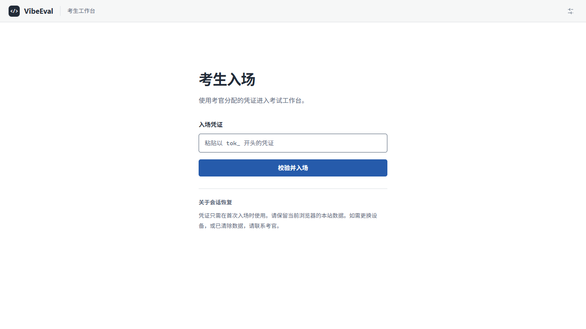
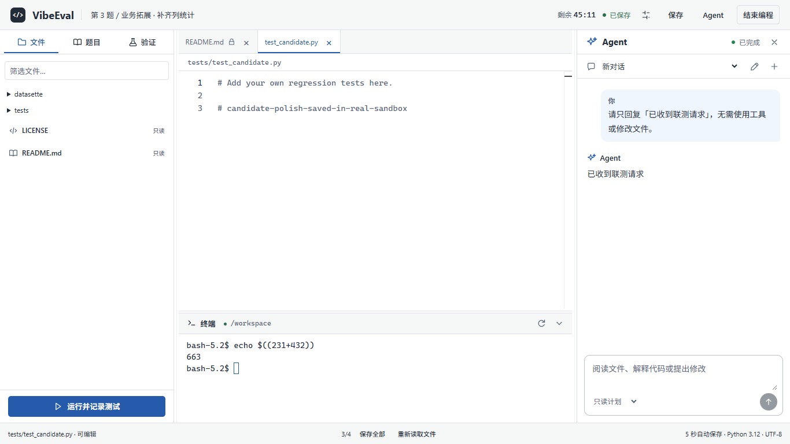

# 四题考生工作台

考生从 `/entry?mode=r2` 入场。冷白、暖白和石墨三种主题覆盖准备、阅读、编程、独立问答与交卷。工作区使用当前考生的会话，文件保存、终端、Agent、公开测试、答题计时和封存都交给四题后端。

## 组员如何试用

需要团队联测服务器的 SSH 访问权限，以及考官在该实例的 `/admin/r2` 为本次体验创建的一次性入场凭证。每位体验者使用各自的考场。首次入场后，用同一浏览器和地址恢复答卷。

1. 切换到本分支。在能访问联测服务器的电脑上保留下列 SSH 连接。把 `TEAM_SSH_HOST` 换成自己的 SSH 配置名或团队提供的登录地址。

   ```sh
   ssh -NT -o ExitOnForwardFailure=yes -L 127.0.0.1:5184:127.0.0.1:18085 TEAM_SSH_HOST
   ```

2. 在另一终端进入仓库的 `frontend`，使用项目支持的 Node.js 版本（22.13+ 的 22.x，或 24+）构建并启动前端。以下为 PowerShell 命令。

   ```powershell
   npm.cmd ci
   npm.cmd run build
   $env:VIBEEVAL_BACKEND_URL = 'http://127.0.0.1:5184'
   npx.cmd --no-install vite preview --host 127.0.0.1 --port 5197 --strictPort
   ```

3. 打开 [考生入场](http://127.0.0.1:5197/entry?mode=r2)。此地址提供刚构建的静态文件，并同源转发真实 API 和 WebSocket。请使用这个完整地址，终端服务会校验浏览器的来源。连接其他已部署的四题实例时，将上游地址和允许的终端来源与部署方配置对齐。

## 验证真实运行

在第三题初始代码上点击「运行并记录测试」，本次联测的列统计题包有一项公开测试失败，退出码为 1。修改文件、保存并再次运行，结果会绑定新的代码版本。结束编程后，可以在「冻结代码」和「操作记录」中对照保存的文件与测试结果。模型状态接口只说明服务端是否配置了模型，实际发送一条消息并收到回答才能验证模型调用。

下图取自 1366 × 768 浏览器中的独立联测考场。第三题编辑器显示已保存的回归文件，终端显示沙箱的计算结果，右侧保留实际模型的回复。





## 合入主线

功能基线为 `codex/r2-grading-jobs@5a93ea6`，对应 [四题功能 PR #12](https://github.com/thuse2026-project/VibeEval/pull/12)。界面改动从该基线独立提交，可用 `git diff 5a93ea6...HEAD` 单独审阅。先合入功能 PR，再以更新后的 `main` 审阅美化分支。若功能 PR 以 squash 方式合入，需将美化提交移到新的主线基线上，避免界面 PR 重复包含四题功能。工作台使用同一组阶段 API 和原有数据库结构。
