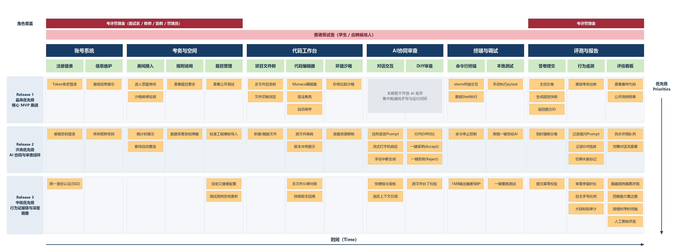
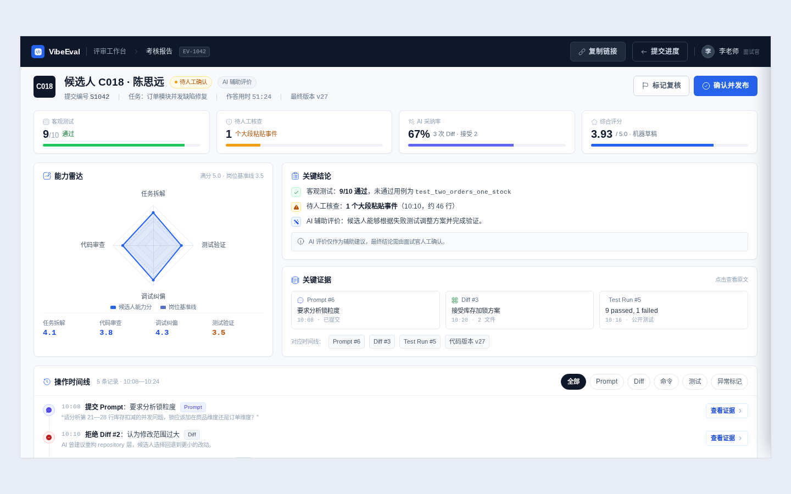

# VibeEval\-AICoding 平台

# 目    录

1. 简介

    - 1\.1 目的（编辑：陈智恒）

    - 1\.2 范围（编辑：陈智恒）

    - 1\.3 定义、缩写词以及简写（编辑：陈智恒）

    - 1\.4 参考文献（编辑：陈智恒）

    - 1\.5 内容组织（编辑：陈智恒）

2. 综合描述

    - 2\.1 产品前景（编辑：陈智恒）

    - 2\.2 产品功能（编辑：刘婧瑶）

    - 2\.3 用户特征（编辑：刘婧瑶）

    - 2\.4 一般性限制（编辑：陈弘毅）

    - 2\.5 假设和依赖（编辑：陈弘毅）

3. 详细需求

    - 3\.1 功能需求（编辑：刘婧瑶）

    - 3\.2 外部接口需求（编辑：陈弘毅）

    - 3\.3 性能需求（编辑：陈弘毅）

    - 3\.4 质量属性（编辑：赵晨一）

    - 3\.5 其他需求（编辑：赵晨一）

4. 支持信息（编辑：赵晨一）

5. 附录

    - 附录A：用户故事地图与用户故事卡（编辑：陈智恒）

    - 附录B：系统总体架构与技术选型（编辑：陈弘毅）

    - 附录C：项目开发迭代计划与任务分工矩阵（编辑：赵晨一）

    - 附录D：系统交互原型设计（编辑：刘婧瑶）

        


---


# 1\. 简介


## 1\.1 目的（编辑：陈智恒）

本文档面向“AI辅助编程面试评估平台”软件的开发者。通过详细介绍平台的基本信息、用户画像和需求标准，帮助开发者理解本平台的功能和用途，设计出有针对性和实用性的软件，准确高效地完成开发过程、解决用户需求。 

## 1\.2 范围（编辑：陈智恒）

本文档所描述的开发产品名为“AI辅助编程面试评估平台”（VibeEval）。
VibeEval 旨在为用户提供一个在真实工程环境下评估和考察 AI 协同编程能力的平台。它将为受试候选人和技术面试官提供各自所需的功能和工具。  
对于受试候选人，VibeEval 将提供一个开箱即用的 Web 端开发与评测环境。候选人无需在本地进行繁琐的环境配置，即可在多文件工程项目中体验与 AI 结对编程的流程。平台提供代码差异对比与审查功能，支持候选人自主选择采纳或调整代码，并在环境中执行测试以验证结果，贴近实际工业界的人机协同开发模式。
对于技术面试官，VibeEval 将提供一套客观量化的能力评估工具。平台记录候选人在解决工程问题时与 AI 的交互过程数据、代码审查行为及测试验证情况。面试结束后，平台结合自动化测试结果与过程数据分析，生成多维度的能力评估报告，帮助面试官了解候选人的工程拆解、代码辨析及排错调试能力。  
VibeEval 是一个评估和考察人机协同编程能力的平台，它并不提供基础大语言模型的训练和调整功能。用户无法在平台上进行模型的训练过程。VibeEval 也不提供音视频会议等通讯服务，它仅仅是一个帮助面试官评估候选人工程与 AI 协同能力的工具。 

## 1\.3 定义、缩写词以及简写（编辑：陈智恒）

SRS：软件需求规格说明书（Software Requirements Specification）  

API：应用程序编程接口（Application Programming Interface） 

GUI：图形用户界面（Graphical User Interface）  

IDE：集成开发环境（Integrated Development Environment）  

LLM：大语言模型（Large Language Model）  

UAT：用户验收测试（User Acceptance Testing）


## 1\.4 参考文献（编辑：陈智恒）

1. CoderPad（现代在线技术面试与沙箱评估平台）: https://coderpad\.io/ 

2. Cursor（基于人机协同与行内差异审查的 AI\-first 编辑器）: https://www\.cursor\.com/ 

3. E2B: Secure Sandboxes for AI Code Execution（微虚拟机与代码沙箱运行时规范）: https://e2b\.dev/ 

4. Monaco Editor（VS Code 网页端核心代码编辑器官方文档）: https://microsoft\.github\.io/monaco\-editor/ 

5. SWE\-bench: Can Language Models Resolve Real\-world GitHub Issues?（真实软件工程任务与缺陷修复评测基准）: https://www\.swebench\.com/ 

6. IEEE Std 830\-1998: IEEE Recommended Practice for Software Requirements Specifications\. 

7. 国家互联网信息办公室等七部门,《生成式人工智能服务管理暂行办法》, 2023\.


## 1\.5 内容组织（编辑：陈智恒）

本文档将按照总分的模式组织内容。第二部分将从总体视角描述产品概况，包括产品的使用前景、可以提供给用户的核心功能、用户特征与平台的限制及依赖关系。第三部分将着重讲述平台的详细需求信息，涵盖功能需求、外部接口、系统性能及质量属性等。第四部分提供支持信息与待确定问题列表。附录中将展示用户故事地图与用户故事卡、系统总体架构与技术选型、项目开发迭代计划及系统交互原型设计。


---


# 2\. 综合描述


## 2\.1 产品前景（编辑：陈智恒）

当前软件研发已进入人机协同编程时代，大模型工具已深度渗透日常开发流程。为了解**真实用户需求，项目组开展了问卷调研**，共回收有效样本 27 份（涵盖在校学生、应聘者、专业教师与技术面试官）。数据表明，85\.19% 的受访者在日常开发中高频依赖 AI 工具（其中 2/3 达到每天必用的程度）。在考核现状方面，66\.67% 的受访者认为传统纯手写算法题脱离工程实际，64\.0% 的受访者反感传统考核过度关注语法记忆与拼写细节而忽略系统设计能力，88\.89% 的受访者赞同使用贴近实战的 AI 协同项目考核替代死记硬背的算法机考。此外，针对考核者（教师与面试官）的调研显示，100% 的考评者最大的困扰之一是“缺乏解题过程记录，无法还原候选人的思考逻辑与代码审查能力”。传统考核亟需向贴近工程实际的人机协同与过程化评估转型。  
目前市场上已存在若干编程评测与协同开发工具，但在 AI 协同工程评估场景下均存在明显局限： 
1\. **传统在线评测平台（如 LeetCode、牛客网及高校 OJ）**：核心采用单文件算法题与黑盒输入输出比对，强制断网且禁用 AI，无法体现多文件依赖、环境调试等真实工程复杂度，也无法考察人机协同素养。
 2\. **在线协同面试平台（如 CoderPad、ShowMeBug）**：侧重实时白板与音视频连麦，缺乏面向多文件工程上下文的内嵌 AI 助手，且无法对候选人的 Prompt 提问演进、代码差异审查（Diff Accept/Reject）等行为进行细粒度遥测与量化建模。
 3\. **AI 原生代码编辑器（如 Cursor、Windsurf）**：虽然具备优秀的工程上下文理解与代码补全能力，但属于个人生产力工具，缺乏考评场景所必需的轻量级微虚拟机隔离、隐藏测试用例静默执行及自动生成能力评估报告的功能。 
VibeEval 是面向 AI 协同编程的新型技术考核平台。平台提供开箱即用的网页多文件沙箱与内嵌 AI 助手，全流程记录受试者提问、审查代码与调试排错的轨迹，并自动生成包含能力雷达图与排错时间轴的量化报告，实现从“死记硬背考算法”向“评估真实工程与人机协同素养”的跨越。

## 2\.2 产品功能（编辑：刘婧瑶）

VibeEval 面向允许使用 AI 的真实工程化编程考核场景，围绕“进入考核—理解任务—编辑与调试—使用 AI—审查变更—提交作答—查看报告”的业务闭环，划分为以下四个核心子系统。

```Plain Text
VibeEval AI Coding 考核平台
├─ 1. 会话与环境准备系统
│  ├─ 授权链接与会话校验
│  ├─ 题目说明及规则告知
│  ├─ 隔离沙箱创建与项目挂载
│  └─ 断线重连与环境回收
├─ 2. Web IDE 与 AI 结对工作台
│  ├─ 文件树、代码编辑器与自动保存
│  ├─ Web 终端与公开测试
│  ├─ 项目上下文选择与 AI 对话
│  ├─ 补丁 Diff 审查、接受与拒绝
│  └─ 命令确认、停止与异常提示
├─ 3. 过程事件与证据采集系统
│  ├─ Prompt、Diff、终端及测试事件记录
│  ├─ 代码版本与操作时间线
│  ├─ 异常行为提示
│  └─ 事件去重、补传与审计索引
└─ 4. 自动评测与能力画像系统
   ├─ 最终答卷冻结与快照
   ├─ 公开测试与隐藏测试
   ├─ 基于证据的辅助评分
   ├─ 能力雷达图与关键事件回放
   └─ 人工复核、意见修订与结果发布
```

### 2\.2\.1 会话与环境准备系统

平台向候选人提供受限的考核入口。候选人通过邀请链接进入会话后，系统校验身份、会话有效期及所属题目，展示考核规则和数据采集说明，并创建与其他用户隔离的作答环境。环境就绪后自动挂载指定版本的多文件项目、运行时和预装依赖，使候选人无需进行本地配置即可开始作答。

系统应持续显示环境状态和剩余时间。发生页面刷新或短时断网时，在会话仍有效且沙箱未到期的前提下，系统恢复最近保存的文件版本、AI 对话及有限终端输出；环境创建失败或会话失效时，应明确说明原因和可执行的恢复操作。

### 2\.2\.2 Web IDE 与 AI 结对工作台

工作台采用接近主流 IDE 的布局，集中提供题目说明、文件树、代码编辑器、终端、AI 助手和提交入口。候选人能够浏览及修改允许编辑的文件、运行预设命令和公开测试，并查看未保存、保存中、已保存、冲突或保存失败等状态。

AI 助手根据候选人主动选择的文件、代码片段及必要项目结构生成解释、修改建议或补丁。任何 AI 补丁在写入工作区前必须通过 Diff 展示影响文件与增删内容，由候选人明确接受或拒绝；AI 建议的命令也必须展示命令内容和执行目录，经校验及候选人确认后才能执行。AI 服务故障时，手工编辑、终端运行和最终提交仍应可用。

### 2\.2\.3 过程事件与证据采集系统

系统记录与能力评价直接相关的过程证据，包括 Prompt 提交、AI 响应状态、补丁接受或拒绝、文件版本变化、终端命令、公开测试结果和最终提交等事件，并按照会话形成可检索的时间线。默认不持续采集原始击键内容；页面失焦、大段粘贴等弱语义信号只形成待人工核查的异常标记，不单独作为作弊或淘汰依据。

候选人在作答前应看到采集范围、用途和评价边界。事件记录应具备唯一标识、服务端时间及会话内单调序号，支持断线补传和重复去重，为后续报告提供可追溯证据。

### 2\.2\.4 自动评测与能力画像系统

候选人确认提交后，系统冻结答卷并生成不可变快照，在独立评测环境中运行公开测试和隐藏测试。客观测试结果与 AI 辅助评价分开展示。辅助评价根据评分量规分析提交代码及必要的过程证据，形成任务拆解、代码审查、调试纠偏、测试验证等维度的评分、证据引用和文字说明。

面试官或课程助教可以查看雷达图、测试摘要和关键操作时间线，并从评价项跳转到对应 Prompt、Diff、终端事件或代码版本。模型输出无效、证据不足或基础设施故障时，报告进入“评分失败”或“待人工复核”状态，不将缺失结果记为零分。最终结论由有权限的评审人员确认并发布。

## 2\.3 用户特征（编辑：刘婧瑶）

### 2\.3\.1 候选人 / 选课学生

候选人是工作台的主要使用者，但不应获得题库管理、隐藏测试、标准答案、其他会话或未发布报告的访问权限。平台不假定候选人了解内部沙箱、事件协议或评测模型，关键状态必须以易理解的界面文案呈现。

### 2\.3\.2 企业技术面试官 / 教师 / 课程助教

评审人员通常时间有限，因此报告首页应先呈现结论摘要和需复核项，再按需展开完整时间线。系统生成的能力分数仅作为辅助建议，评审人员负责作出最终教学或招聘判断。

### 2\.3\.3 题库管理员 / 出题人

题库管理员拥有题目配置权限，但默认无权修改已冻结答卷或替代评审人员发布最终评价。

### 2\.3\.4 系统管理员

系统管理员负责保障平台运行，其质量与运维要求由 3\.4、3\.5 节统一约束；交互原型中以评审报告和评测进度界面体现其可观测的状态信息，不单独设计管理员后台页面。

## 2\.4 一般性限制（编辑：陈弘毅）

### 2\.4\.1 产品与交付范围

VibeEval 通过 Web 页面提供 AI 辅助编程考核环境。候选人通过授权入口进入工作区，完成文件编辑、AI 补丁审查、命令运行、测试验证与答卷提交；面试官或课程助教查看报告并进行复核。题库管理员维护工程模板、测试套件与运行配置。

**CON\-01 使用范围。** 一期面向小规模、预先授权的考核，保留招聘面试与课程考核共用的作答流程，不实现企业 ATS、音视频会议、模型训练和多人同时编辑同一工作区。课程中的教师/助教使用评审角色，不另建一套教学管理系统。

**CON\-02 语言与终端。** 开发先用 Python 跑通闭环，随后按现有版本计划补齐 JavaScript/TypeScript 工程模板；支持范围以已发布、已测试的模板为准。每个题目固定语言运行时、依赖和命令，候选人不负责安装基础工具。

**CON\-03 AI 修改规则。** 一期采用“读取上下文—提出补丁—候选人确认—运行验证”的受控方式。模型产生的补丁在确认前不得写入作答文件。模型提出命令后，须经权限检查及候选人确认才能执行；终端命令可能修改文件，因此命令确认不等同于逐文件 Diff 确认，界面须明确提示。所有实际变更均关联版本记录。自主连续执行模式不列为一期验收要求。

### 2\.4\.2 开发与部署约束

**CON\-04 工程约定。** 使用 Git 与 GitHub 管理代码，功能变更通过 Pull Request 合并，至少经一名非作者审查。依赖使用锁文件，镜像记录不可变标识；代码格式、基础测试和配置检查纳入 CI。不得提交真实服务密钥、用户答卷或未脱敏日志。

**CON\-05 部署边界。** 业务控制服务部署在 Linux 环境，前端采用 React \+ TypeScript，后端采用 Python \+ FastAPI，元数据使用 PostgreSQL。沙箱主方案为 E2B 托管环境，业务服务通过适配层访问。具体版本在首轮技术验证后写入部署清单，不使用浮动版本作为验收依据。详细选型理由见附录 B。

**CON\-06 客户端范围。** 正式验收覆盖桌面端 Chrome、Edge，记录实际测试版本，基准视口为 1366×768；浏览器需启用 JavaScript、Cookie 及安全长连接。支持标准键盘和鼠标，不要求安装本地编程环境。较小窗口允许折叠面板；移动端、Safari 和 Firefox 暂不作为必须通过的验收环境，不宣称全浏览器兼容。

### 2\.4\.3 隔离、资源与数据边界

**CON\-07 隔离要求。** 每个会话拥有独立工作区与执行环境。业务服务不得直接执行候选人代码；考生和模型不得访问其他会话、业务数据库、宿主机控制接口、平台凭证及隐藏测试。作答环境与独立评测环境分离。gVisor 与 Firecracker 是不同隔离路线，不能把所有沙箱统称为微虚拟机。

**CON\-08 网络与资源。** 作答及评测环境默认禁止出站网络，题目依赖在发布前预装。模型由业务服务调用，不依赖作答沙箱联网。单会话资源、执行时间、终端输出、文件容量、模型请求和 token 预算均须设上限；达到上限时明确告知，不无限重试或无限生成。建议初始配额见附录 B，需与实际服务套餐匹配后冻结。

**CON\-09 数据使用。** 考前说明采集的对话、代码变更、执行和提交记录及用途。默认不采集原始击键节奏；页面失焦等事件若保留，仅作待人工核查信息。模型仅接收本次任务必要上下文，不接收候选人身份、隐藏用例、标准答案或服务密钥。数据保留、删除与访问权限遵循第 3\.4、3\.5 节统一规定。

**CON\-10 评测边界。** 自动测试结果与模型辅助评价分开展示。模型评价必须给出可定位的证据引用，不能自动作出录用、淘汰或作弊结论。缺少证据、调用失败或基础设施故障不得作为零分；由评审按明确状态复核。平台不声称仅凭操作轨迹即可准确推断独立编程能力。


## 2\.5 假设和依赖（编辑：陈弘毅）

以下条件构成部署和验收前提。依赖不满足时，系统仍应保留已确认保存的数据并给出可理解的状态，不能以“假设网络正常”为由省略异常处理。

|编号|假设或外部依赖|验证方式|不满足时的处理|
|---|---|---|---|
|DEP\-01|团队具备可用的 DeepSeek API 凭证与预算|在部署地域进行最小流式调用、工具参数及错误处理验证|AI 功能标记不可用，保留编辑、运行和提交；告知评审受影响会话|
|DEP\-02|选定 DeepSeek 模型支持项目所需接口|启动前探测配置模型，验证文本流、工具建议及结构化结果|禁止静默切换模型；修改配置需记录并评估公平性影响|
|DEP\-03|E2B 账号可提供所需并发、时长、PTY、模板及网络控制|验证创建、交互终端、读写、停止、到期、回收和禁网行为|未通过时不发起正式考核；评估本地 Docker \+ gVisor 备选并同步修订部署与性能条件|
|DEP\-04|考核时长、交卷与恢复缓冲不超过沙箱实际生命周期能力|检查套餐及超时策略，执行一次完整会话|不把重新创建的环境冒充原会话恢复；优先调整配额、套餐或考核安排|
|DEP\-05|候选人具备基础浏览器和编程操作能力|考前提供打开文件、编辑、测试的练习任务|操作引导不计入正式考试时间|
|DEP\-06|浏览器与服务之间可以建立 HTTPS/WSS 连接|登录后健康检查和重连测试|提示阻断原因；未就绪不开始计时；作答中断线按既定规则处理|
|DEP\-07|题目模板、参考解与测试套件可复现|发布前运行模板检查、参考解和典型错误解|校验失败的题目不得发布；已发场次锁定旧版本|
|DEP\-08|评审提供评分量规和证据解释规则|用少量匿名样例试评，检查规则能否落到证据|量规未确定时仅发布测试结果和事实记录，不伪造能力分数|
|DEP\-09|控制服务具有独立持久化和备份空间|检查磁盘、备份与恢复结果|资源不足提前拒绝创建新会话，不删除正在作答的数据|

模型标识与参数由配置管理。即使固定调用名称，供应商仍可能更新其对应模型；因此平台记录请求模型标识、响应可得的版本信息、调用时间和配置版本，但不承诺外部服务永久保持同一权重。成本按实际账单和 usage 记录核对，文档不固定外部服务单价。


---


# 3\. 详细需求

## 3\.1 功能需求

本节依据 2\.2 的子系统划分和附录 A 的用户故事，逐项细化功能条款。每条需求按“输入、处理、输出”描述，并补充异常与验收约束；FR 编号同时用于第 4 章需求追踪和附录 D 原型核对。附录 A 中标注 Could 的增强型故事（如历史版本回溯、横向对比看板）在本节以低优先级条款承接，不纳入一期验收基线。

|功能编号组|对应子系统|对应原型界面|
|---|---|---|
|FR\-SESSION|会话与环境准备系统|界面一、界面二|
|FR\-WS|会话与环境准备系统 / Web IDE 工作台|界面二、界面三|
|FR\-AI|Web IDE 与 AI 结对工作台|界面三|
|FR\-TEST / FR\-TEL|过程事件与证据采集系统|界面三、界面五|
|FR\-SUB / FR\-EVAL|自动评测与能力画像系统|界面四、界面五|
|FR\-ITEM|考务配置后台能力|不单独设计原型页面|

### 3\.1\.1 会话接入与规则确认

**FR\-SESSION\-01 会话接入。**

- 输入：候选人邀请凭证或授权链接。

- 处理：系统校验凭证有效期、会话状态、用户角色和会话归属，以一次性邀请凭证换取受限登录会话，并从地址栏移除邀请凭证。

- 输出：有效用户进入考前确认页；无效、过期或已结束的会话显示稳定错误码及处理建议。

- 验收：候选人不得通过修改 `session_id` 访问其他会话；重复打开有效链接不会创建多个独立答卷。

**FR\-SESSION\-02 规则与采集告知。**

- 输入：当前场次的考核说明、允许/禁止操作、数据采集项和提交规则。

- 处理：系统完整展示规则，要求候选人主动确认；确认记录绑定规则版本、用户和时间。

- 输出：确认成功后允许创建环境；未确认前不得开始正式计时和作答。

- 验收：页面至少说明 Prompt、代码变更、终端命令、测试和提交事件的用途，并注明异常信号需人工核查。

### 3\.1\.2 环境生命周期与工作区

**FR\-WS\-01 隔离环境创建。**

- 输入：会话标识、锁定的题目版本、运行镜像和资源配置。

- 处理：系统以幂等操作创建独立沙箱，挂载项目模板和预装依赖，完成文件与终端健康检查。

- 输出：返回“创建中、已就绪、创建失败或可重试”状态；就绪后展示文件树和题目说明。

- 异常：60 秒内仍未就绪时不得无限等待，应显示失败原因或重试入口；重复请求不得重复分配环境。

**FR\-WS\-02 文件浏览、编辑与保存。**

- 输入：候选人选择的文件、编辑内容及客户端已知版本号。

- 处理：系统校验文件路径和写权限，进行版本冲突检查并持久化新版本；持续编辑时至少每 5 秒尝试自动保存。

- 输出：编辑器展示语法高亮及“未保存、保存中、已保存、冲突、保存失败”状态，保存成功返回新版本号。

- 异常：禁止越界路径、危险符号链接、超大文件和受保护文件写入；发生冲突时保留双方内容并提示刷新或比较，不静默覆盖。

**FR\-WS\-03 终端与命令执行。**

- 输入：键盘输入、终端尺寸、用户确认后的命令及停止指令。

- 处理：系统通过安全长连接代理至当前会话的 PTY，按资源与超时限制执行命令，并使用有界缓冲保存输出。

- 输出：实时回显标准输出、错误输出、退出码和运行状态；执行中的命令可停止。

- 异常：断线时明确显示重连状态，终端输入不得自动重放；重连后只恢复有限输出并提示可能的截断。

**FR\-WS\-04 断线恢复与环境结束。**

- 输入：页面刷新、网络恢复、会话到期或管理员结束指令。

- 处理：有效会话重新鉴权，恢复最近文件版本、AI 对话、状态事件和有限终端输出；会话结束时停止写入并按策略回收沙箱。

- 输出：恢复成功后回到工作台；不能恢复时说明最近已保存版本及后续处理方式。

- 验收：后端正常且沙箱未到期时，95% 的会话在网络恢复后 5 秒内重新可交互。

**FR\-WS\-05 历史版本回溯（Could / Release 3\.0）。**

- 输入：候选人选择的文件版本或工作区快照标识。

- 处理：系统校验版本归属和当前会话状态，暂停相关写入后，将工作区恢复到指定版本；恢复本身生成新版本和对应事件记录。

- 输出：展示恢复后的文件内容、版本号以及与恢复前版本的差异摘要。

- 异常：正在写入文件时须先协调写进程；已冻结或已结束的会话不接受回溯；恢复不删除旧版本及其事件。

### 3\.1\.3 AI 结对助手与变更审查

**FR\-AI\-01 上下文选择与提问。**

- 输入：自然语言 Prompt、候选人主动选中的文件或代码片段，以及当前允许使用的项目结构摘要。

- 处理：系统检查上下文范围和 token 预算，过滤隐藏测试、密钥及受保护内容，构造本次 AI 请求。

- 输出：立即显示等待或排队状态，并以流式 Markdown 展示有效文本；记录请求、响应状态及上下文引用摘要。

- 异常：达到预算、限流、超时或取消时显示明确状态；AI 不可用不应阻断手工编辑、运行测试和提交。

**FR\-AI\-02 补丁生成与 Diff 展示。**

- 输入：模型生成的补丁、目标文件路径和基础版本号。

- 处理：系统校验路径、大小、语法格式、基础版本和可应用性，生成逐文件 Diff。

- 输出：展示影响文件、增删行、基础版本及“接受、拒绝”操作；多文件补丁应按文件分组。

- 异常：补丁无效或基础版本过期时标记失败/冲突，不允许直接覆盖候选人的后续修改。

**FR\-AI\-03 补丁接受、拒绝与回滚。**

- 输入：候选人的接受或拒绝指令。

- 处理：接受时在写锁内再次校验所有文件并原子应用补丁，生成新文件版本；任一文件失败则整体回滚。拒绝时丢弃待应用补丁但保留对话及拒绝事件。

- 输出：接受后编辑器刷新并标示已变更文件；拒绝后文件保持不变；两种操作均更新事件时间线。

- 验收：未经候选人明确接受，AI 补丁不得写入作答文件。

**FR\-AI\-04 AI 建议命令确认。**

- 输入：模型建议的命令、执行目录及候选人的确认/拒绝指令。

- 处理：平台执行权限和危险模式检查，确认后才发送至沙箱；以调用 ID 防止重复执行。

- 输出：确认界面展示完整命令、目录和“命令可能修改文件”的提示；执行结果进入终端并关联原始 AI 请求。

- 异常：拒绝、取消或校验失败时不得执行；连接重试不能导致同一命令再次运行。

**FR\-AI\-05 终端报错关联 AI（Should / Release 2\.0）。**

- 输入：候选人从终端中选择并发送的报错文本、测试输出或命令历史摘要。

- 处理：系统对输入做脱敏和大小限制，作为上下文追加到当前 AI 会话，并标明来源为终端事件。

- 输出：AI 在对话中引用该终端输出给出排错建议；终端事件与 AI 请求建立关联记录。

- 异常：超过长度限制时截断并提示；AI 不可用时仍允许复制或手动粘贴，不阻断排错流程。

### 3\.1\.4 公开测试与过程证据

**FR\-TEST\-01 公开测试。**

- 输入：候选人点击“运行测试”或执行题目允许的测试命令。

- 处理：系统在当前作答沙箱中按资源和超时限制运行公开测试，采集用例摘要、退出码和输出。

- 输出：展示通过、失败、超时或基础设施异常状态，并将测试结果关联到当时的代码版本。

- 异常：候选人代码导致的测试失败与平台故障必须区分，不得统一显示为系统错误。

**FR\-TEL\-01 过程事件记录。**

- 输入：Prompt 提交、AI 状态、Diff 操作、文件版本、终端命令、公开测试和提交等业务事件。

- 处理：服务端为事件分配唯一标识、时间戳和会话内单调序号，持久化必要摘要；断线重报时按事件标识去重。

- 输出：形成按时间排序、可筛选并能定位原始证据的会话时间线。

- 约束：默认不记录连续原始击键；事件只对有权限的候选人、评审或管理员按各自范围开放。

**FR\-TEL\-02 异常行为标记。**

- 输入：页面失焦、大段粘贴、异常频率操作等已告知的信号。

- 处理：系统根据预设规则生成带时间和上下文的待核查标记，不直接改变能力分数或考核结论。

- 输出：评审报告显示“需人工核查”及事实描述；候选人可按既定流程提出说明或申诉。

- 验收：单一异常信号不得自动触发作弊定性、零分或淘汰。

### 3\.1\.5 最终提交与自动评测

**FR\-SUB\-01 最终提交确认。**

- 输入：候选人点击“提交答卷”及二次确认。

- 处理：系统提示剩余时间和未保存状态，停止新的写入，等待进行中的保存结束，生成不可变快照，并以幂等方式创建提交及评测任务。

- 输出：返回唯一提交编号和“冻结中、已接收、排队评测”等状态。

- 异常：快照未成功上传并校验时不得显示“已提交”；网络重试不得生成多份逻辑答卷。

**FR\-EVAL\-01 客观测试执行。**

- 输入：最终提交快照、锁定的题目版本、公开/隐藏测试版本和可信评测配置。

- 处理：系统在独立评测环境中导入允许修改的候选人代码，运行测试并记录镜像、测试套件和执行 attempt。

- 输出：生成结构化的通过数、失败数、超时、错误摘要和必要日志；候选人可见内容不得泄露隐藏用例细节。

- 异常：评测基础设施故障进入可重试状态，不计为候选人测试失败或零分。

**FR\-EVAL\-02 证据化辅助评分。**

- 输入：提交代码、客观测试摘要、评分量规版本，以及经脱敏筛选的 Prompt、Diff 和调试事件。

- 处理：评测模型按任务拆解、代码审查、调试纠偏、测试验证等维度生成结构化结果；系统校验字段、分值范围和证据引用是否存在。

- 输出：生成维度得分、置信/待核查提示、证据引用及文字评价；客观结果和模型推断分区展示。

- 异常：输出无效、证据不足、超时或模型失败时标记“待人工复核/评分失败”，不得虚构分数。

**FR\-EVAL\-03 报告查看与人工复核。**

- 输入：评审人员选择某次提交，筛选维度、事件类型或异常标记，并提交复核意见。

- 处理：系统校验报告访问权限，加载摘要、雷达图和分页时间线；支持从评价跳转至对应 Prompt、Diff、终端事件、测试摘要或代码版本。

- 输出：评审人员可确认、修订辅助评价并留下修订理由和版本记录；候选人只查看已授权发布的结果。

- 验收：任何模型评价都不能自动作出录用、淘汰或作弊结论。

**FR\-EVAL\-04 同场次横向对比看板（Could / Release 3\.0）。**

- 输入：评审人员选择的场次、候选人范围及对比维度。

- 处理：系统仅在同一场次、同一题目版本和同一评测版本内计算分数分布与分位数，隐藏未发布报告。

- 输出：展示综合成绩分布、候选人在各维度的相对位置，并注明对比口径和样本数量。

- 约束：不同题目、不同版本或不同量规的分数不直接横向比较，避免破坏公平性；该能力不替代人工复核。

### 3\.1\.6 题目配置与发布

**FR\-ITEM\-01 题目配置。**

- 输入：项目模板、语言、运行镜像、启动/测试命令、资源配额、允许修改路径、公开/隐藏测试和评分量规。

- 处理：系统进行字段、路径、命令和资源配置校验，为配置生成版本号。

- 输出：保存草稿并展示配置校验结果；未通过校验的题目不得发布。

**FR\-ITEM\-02 发布前验证与版本锁定。**

- 输入：待发布题目版本、参考解和典型错误解。

- 处理：系统构建或验证运行环境，分别运行初始模板、参考解及典型错误解，检查测试区分度和隐藏资产隔离。

- 输出：生成发布检查报告；通过后将题目版本标记为可用。

- 约束：会话开始时锁定题目、镜像、测试和量规版本，后续更新不得改变已开始场次的评价标准。

    

## 3\.2 外部接口需求（编辑：陈弘毅）

### 3\.2\.1 用户界面接口

**IF\-UI\-01 工作台。** 页面包含题目和剩余时间、文件树、代码编辑器、终端、AI 面板，以及保存、测试和提交状态。具体布局及交互原型以附录 D 为准；各面板可折叠，不强制开发移动端编辑界面。

**IF\-UI\-02 明确反馈。** 界面区分“未保存、保存中、已保存、冲突、保存失败”；AI 区分“等待、生成中、待确认、执行中、完成、取消、失败”；提交区分“冻结中、已接收、排队评测、测试完成、辅助评价中、待复核、报告完成”。不得把网络请求已发送显示为已保存或已交卷。

**IF\-UI\-03 补丁与命令确认。** Diff 显示影响文件、增删内容与基础版本，提供接受和拒绝操作。过期补丁显示冲突，不能覆盖用户后续修改。命令确认展示命令内容、执行目录与可能写文件的提示，执行中可停止。

**IF\-UI\-04 故障与复核。** 断线、资源不足和外部服务失败时显示原因、已保存版本及允许的恢复操作。候选人能获得提交编号；评审可从评价跳转到对应事件、差异或测试摘要。未经发布的报告与隐藏测试详情不得向候选人开放。

### 3\.2\.2 硬件接口

平台不直接控制专用工业设备，不要求摄像头、麦克风、GPU 或本地 KVM。候选人通过标准 PC 浏览器输入和查看结果。业务服务器与沙箱资源由部署方提供；使用托管沙箱不要求业务服务器本地具备虚拟化扩展，自建备选方案另做硬件与兼容性验证。

### 3\.2\.3 DeepSeek 模型服务接口

**IF\-AI\-01 接入方式。** 暂定使用 DeepSeek API，由后端统一访问 `https://api.deepseek.com/chat/completions`，采用 Bearer 鉴权及 JSON 请求。接口地址、调用模型、上下文上限、输出上限和超时均由服务端配置，密钥不能下发到浏览器或沙箱。模型具体名称在账号能力验证后冻结。\[C\-R1\]

**IF\-AI\-02 流式与工具。** 文本使用流式响应并转为平台事件；工具调用由模型提出、平台校验和执行，不把模型输出当作已执行命令。工具参数流接收完整且通过校验后才能展示确认。候选人拒绝或调用取消时记录状态，不继续执行待处理工具。\[C\-R2\]\[C\-R3\]

**IF\-AI\-03 业务输出校验。** 补丁必须验证路径、基础版本、大小及可应用性。报告即使采用 JSON Output，仍须检查字段、类型、分值范围、证据存在性和完整性；空内容、截断或无效结果进入失败/待复核状态，不能填入虚构评分。\[C\-R4\]

**IF\-AI\-04 失败与重试。** 认证、余额、参数错误不自动循环重试；限流及暂时服务错误采用带抖动退避，最多自动重试两次且受总超时与预算限制。已产生部分响应时保留“不完整”标记，重新生成创建新 attempt，不拼接成原答案；工具执行以调用 ID 去重。用户取消会阻止后续工具，但不承诺撤销供应商已发生的用量。\[C\-R5\]

**IF\-AI\-05 两类模型任务。** 编程助手与辅助评审使用独立的系统提示、输入集合和任务标识，即使由同一 DeepSeek 服务提供，也不得共享会话记忆。辅助评审仅接收脱敏的已提交代码、记录和测试摘要，默认不发送隐藏测试源代码；其结果作为辅助建议，面试官可修订并留痕。

### 3\.2\.4 沙箱与存储接口

**IF\-SB\-01 沙箱契约。** 适配层统一提供创建、查询就绪、连接 PTY、读写文件、执行/停止命令、导出快照、销毁等操作。除创建外的调用都绑定会话与沙箱 ID；创建以会话操作 ID 去重，超时后先查询结果，避免重复分配。创建结果应包含模板标识、生命周期、资源限制与状态。适配层不把某一供应商 SDK 对象暴露给前端。\[C\-R6\]\[C\-R8\]

**IF\-SB\-02 文件与运行。** 路径解析限制在指定工作区，禁止越界、危险链接、超大文件和受保护配置写入。写入提交预期版本，成功返回新版本及内容摘要；跨文件补丁需在写锁内整体校验并提交，失败时回滚。用户终端可能产生并发写入，快照或补丁应用时必须协调停止相关写进程，不能仅锁 HTTP 接口。

**IF\-SB\-03 隔离评测。** 评分服务取得不可变提交快照，从可信模板重建评测环境，按允许修改范围导入候选人代码。评分配置、隐藏测试及结果通道不沿用考生可改的配置；候选人 stdout 不得被直接解析成可信分数。对同进程执行不可信代码的残余风险进行专项测试，不能以“测试只读”宣称绝对可信。

**IF\-DATA\-01 数据交互。** PostgreSQL 保存会话、提交、配置版本、事件索引及评分记录；大文件、快照与完整运行输出保存在受访问控制的文件存储。Redis 用于队列通知和短期缓存，不作为答卷或事件的唯一存储。对象引用包含归属、摘要和大小，未上传成功并验证的快照不能被标记为提交完成。

### 3\.2\.5 通信与认证接口

**IF\-NET\-01 协议分工。** 普通操作采用 HTTPS/JSON；终端输入输出与 resize 采用 WSS；AI、作答状态和报告进度采用 HTTPS SSE 事件流。SSE 是单向服务端推送，用户发送消息和取消分别使用 POST，不把 SSE 写成 WSS。

**IF\-NET\-02 鉴权。** 部署采用同源入口及 HttpOnly、Secure 会话 Cookie；改变状态的 HTTP 请求验证 CSRF，WSS/SSE 验证身份、Origin、会话归属及有效期。邀请凭证只用于换取受限会话，随后从地址栏清除；不在连接 URL、日志和前端配置中放长期 API 密钥。候选人不能凭任意 session\_id 访问其他会话。

**IF\-NET\-03 事件恢复。** 持久事件至少包含 `event_id、session_id、seq、type、actor、server_time、correlation_id、payload_ref`。平台按会话分配持久单调序号，客户端从最后确认序号恢复；重复事件去重，超出保留窗口时返回明确的缺口状态。终端输入不自动重放，避免重复执行；输出仅恢复有限缓冲并提示截断。

**IF\-NET\-04 通用错误。** 错误包含稳定业务码、用户提示、请求 ID、是否可重试；不返回密钥、内部路径或隐藏用例。建议业务码包括 `SESSION_EXPIRED、VERSION_CONFLICT、SANDBOX_UNAVAILABLE、AI_RATE_LIMITED、AI_BUDGET_EXCEEDED、GRADING_INFRA_ERROR`。正常考生代码测试失败使用测试结果，不混作平台接口异常。


## 3\.3 性能需求（编辑：陈弘毅）

### 3\.3\.1 基准条件与统计规则

本节为拟定验收基线。开发前由成员 C、D 根据实际资源确认并形成版本记录；未经变更评审不得在测试后通过缩小负载来声称达标。

1. 控制端基准为 Linux、4 vCPU、8 GiB 内存、SSD，部署 API、worker、PostgreSQL 与 Redis；作答和评测计算由托管沙箱另行提供，不包含在上述 8 GiB 内。

2. 最终负载目标为 20 个独立作答会话，每个会话一条终端连接及一条状态事件连接；最多 5 个并行模型请求，最多 2 个评测作业，其余排队。云端并发和预算必须另行满足。

3. 基准工程最多 200 个文本文件、可编辑内容总量 10 MiB、单文件 1 MiB；依赖预装且不计入可编辑内容。性能测试中的固定公开测试命令在单会话资源下应能在 2 秒内完成。

4. 受控网络客户端至业务入口 RTT 不超过 50 ms、丢包率低于 1%；真实互联网另测并如实记录，不混入受控基线。沙箱地域和服务往返耗时单独记录。

5. p95 使用已完成样本统计，同时单列失败、超时、取消和排队，禁止删除慢样本。普通请求至少 500 次，环境准备至少 50 次，在线负载持续至少 30 分钟；真实模型调用先收集至少 30 次作探索性测量，不宣称得到稳定供应商 SLA。

### 3\.3\.2 性能指标与验收方法

|编号|指标及测量起止点|设计目标|验收方法|
|---|---|---|---|
|PERF\-01|登录后普通元数据 API，从服务端接收至响应发出，不含外部调用|p95 ≤ 500 ms，合法请求错误率 \<1%|20 会话混合负载；错误请求另测|
|PERF\-02|保存小文件，从客户端发送到收到持久保存版本确认|100 KiB 文件 p95 ≤ 1 s|每会话每 5 s 保存一次；核验落盘内容和版本|
|PERF\-03|环境创建，从平台接受创建任务至文件及终端健康检查通过|预建模板启动 p95 ≤ 10 s；60 s 内未就绪须进入明确失败/可重试状态|50 次创建，记录排队与供应商耗时；首次构建镜像另计|
|PERF\-04|终端回显，从客户端发送单字符至收到对应输出|受控网络下 p95 ≤ 250 ms|20 条真实 PTY；用无业务运算的回显测量，不把编译耗时计入|
|PERF\-05|AI 请求接受反馈，从用户发送至显示等待/排队状态|p95 ≤ 1 s|模型模拟服务与真实调用均测|
|PERF\-06|AI 端到端首个可展示文本，不把连接心跳或空块当作首字|观察目标 p95 ≤ 10 s；30 s 无有效进展显示等待和取消；单次请求总超时 120 s|固定模型与上下文档位，分别记录排队、供应商与平台转发；未达观察目标仍需报告|
|PERF\-07|AI 平台转发，从适配层收到有效块至送入前端连接输出|p95 ≤ 200 ms|固定模拟流测试，包含慢客户端背压|
|PERF\-08|最终提交，从服务端接收到返回持久提交编号|基准工程 p95 ≤ 5 s；冻结未完成不得假回执|包括停止写入、快照和入库；重复提交、运行中提交另测|
|PERF\-09|客观评测，从 worker 领取任务至结构化测试结果落库|基准任务 p95 ≤ 30 s；队列等待单列|固定测试集和 2 个评测并发；任务硬超时设 60 s|
|PERF\-10|报告展示，已有分页摘要从请求至首屏可用|1 万事件会话中每页 100 条，p95 ≤ 2 s|仅加载摘要与索引，不一次拉取全部日志|
|PERF\-11|重连恢复，网络恢复至文件及对话可交互|后端正常且沙箱未过期时 p95 ≤ 5 s|与第 3\.4\.3 节同一指标、同一测试；不含已销毁沙箱重建|
|PERF\-12|并发与资源稳定性|20 会话下上述适用指标达标，无跨会话干扰和 OOM；控制服务内存峰值 ≤ 80%|每会话每 5 s 保存、每 30 s 跑固定测试、每 120 s 发 AI 请求（错峰）；同时 2 个评测作业|

PERF\-06 是外部依赖观察目标，平台必须兑现的是等待提示、超时、取消和降级规则；它不是对 DeepSeek 延迟的担保。辅助模型评价使用独立任务，默认总处理预算 180 s（含有界重试）；排队另计，超预算进入待复核。人工审核时间不计入自动报告时限。

### 3\.3\.3 容量与性能设计原则

文件编辑采用自动保存与版本校验，避免每次击键全量上传；持续编辑至少每 5 秒尝试保存，并明确确认状态。日志输出使用有界缓冲和分页，后台作业限制并发。请求 handler 不同步等待完整评测，耗时 SDK 调用不能阻塞事件循环。预热池仅作为测得启动瓶颈后的优化，不列为首版必要组件。

每场考试记录活跃沙箱分钟、峰值并发、模型 usage、失败重试和评测耗时。模型预算、沙箱资源不足或等待队列超限时应拒绝或排队并提示，不以影响已有会话为代价无限接收新会话。月可用性、覆盖率、备份 RPO/RTO 等质量指标沿用第 3\.4、3\.5 节，不在本节另设冲突数值。


## 3\.4 质量属性（编辑：赵晨一）

本节规定 AI 辅助编程面试评估平台的非功能质量要求，作为开发、测试和验收的共同依据。质量目标主要覆盖可用性、安全性、可靠性、易用性、可维护性及评测可信度。

### 3\.4\.1 可用性

平台应保证候选人能够在规定面试时段内正常进入工作区、编辑文件、执行终端命令并提交作答。正式部署后，以自然月为统计周期，核心答题服务的目标可用性不低于 **99\.5%**；可用性以端到端合成检查结果计算，计划维护时间是否扣除应在上线前统一约定。对课程项目，最终验收以可用性监控机制、故障注入测试和连续运行记录证明上述目标具有可测量性，不以短期演示冒充整月运行结果。

对资源耗尽、外部模型限流及沙箱实例创建失败等情形，系统应显示明确状态，并允许在权限有效、会话未终止时重试。AI 助手和报告生成服务的局部故障不得使已运行的 Web IDE 和终端同步失效；已接收的文件修改与提交记录不得因页面刷新而丢失。

### 3\.4\.2 安全性与隐私保护

平台采取“业务权限控制—沙箱隔离—评测资产隔离—审计追踪”的分层防护策略。候选人、面试官和题库管理员使用独立的角色权限；所有读取会话、代码、操作轨迹及评测报告的接口均须进行服务端身份认证及会话归属检查，不得仅依赖前端按钮的显示与否控制访问。

候选人代码必须在有资源配额与网络访问策略的独立沙箱中执行，原则上使用非特权用户，禁止挂载宿主机敏感目录和访问宿主机控制接口。沙箱网络采用默认拒绝、按需放通的策略；不允许向平台管理网络、数据库及其他候选人工作区发起访问。具体运行时选用 E2B、gVisor 或 Firecracker，由成员 C 在技术选型阶段确定，但隔离要求不因选型不同而降低。

隐藏测试用例、标准答案、评分密钥与大模型服务 API Key 均不得存放在候选人可读的工作区。隐藏测试由受信任的评测执行环境加载，其详细内容不应进入普通终端输出、候选人可见日志、AI 助手上下文或公开接口响应。系统必须把来自候选人、题目代码仓库和模型输出的文本视为不可信输入，不得因为其中出现“忽略规则”“读取密钥”等指令而提升权限或暴露系统提示词和评测资产。

对于 Prompt、代码改动、页面失焦等行为数据，应在答题开始前明确告知采集目的、范围和用途，并实行最小必要采集。默认记录可用于能力评估的行为事件与变更摘要，避免持续保存无关的原始击键内容；如扩展采集粒度，必须同步更新告知文本与权限控制。疑似异常粘贴、频繁失焦等信号只生成 **待人工核查的异常标记**，不得单独触发作弊定性或自动淘汰。

### 3\.4\.3 可靠性与可恢复性

编辑器应在持续编辑期间至少每 5 秒尝试进行一次自动保存，并在收到服务端持久化确认后显示保存成功。发生网络中断或页面刷新时，系统应恢复最近一次成功保存的文件版本；对于尚未确认保存的本地修改，应尽可能保留并向用户提示，不得将未完成的保存操作标记为成功。

遥测事件使用唯一事件标识、会话标识及单调序号，服务端需支持重复上报去重与断线补传，避免报告中的统计因重试而重复计算。同一提交请求应具有幂等性，网络重试不得生成多份逻辑不同的最终答卷。测试执行记录必须保留题目版本、沙箱镜像版本、测试套件版本和评分规则版本，以保证客观测试结果可追溯。LLM 评分可能存在随机性，因此不要求每次自然语言评语逐字一致，但应保留输入证据、模型及 Rubric 版本供复核。

### 3\.4\.4 易用性

候选人答题界面应沿用主流 IDE 的基本交互习惯，保持文件树、代码编辑器、终端和 AI 侧边栏布局稳定。首次进入会话时，系统只提供简短的操作提示，展示“打开题目—修改代码—运行测试—使用 AI—提交”的最短路径，而不要求安装本地开发环境。

在至少 5 名具备基础编程经验、此前未使用本平台的测试者参与的可用性测试中，目标为 **至少 80% 的测试者能够在 2 分钟内完成打开文件、修改一行代码并运行命令的基础任务**。所有重要按钮应具有文本标签或悬浮说明；AI 补丁需明确展示影响文件及修改内容，避免在用户尚未确认的情况下自动覆盖代码。

### 3\.4\.5 可维护性、可扩展性与可移植性

系统在结构上分离 Web IDE、会话业务、AI 网关、沙箱适配器、遥测采集和报告评估模块。外部模型应通过统一适配层调用；在新供应商支持既定接口能力的前提下，更换模型供应商不应要求修改候选人端主要交互逻辑。沙箱引擎同样应通过标准化生命周期接口连接业务服务，避免业务代码依赖某一厂商的私有接口。

核心业务接口与事件格式应采用版本管理，接口变更需配套迁移说明和自动化测试。平台至少应预留增加题目语言运行镜像、扩展评分维度、替换可视化组件的能力。代码应支持在标准 Linux 服务器环境部署，并以容器化或等价的环境封装减少开发机与验收环境之间的差异。

### 3\.4\.6 可测试性与评测可信度

登录鉴权、会话生命周期、Diff 确认、事件归档、答卷提交和客观测试执行等关键模块应具备单元测试与集成测试。要求核心业务逻辑的自动化单元测试行覆盖率不低于 **80%**，并在持续集成流程中执行必要的冒烟测试与安全检查。自动化测试通过率和人工测试结论均应形成可追溯记录。

综合评分以可验证的代码测试结果和候选人真实操作证据为基础。LLM\-as\-a\-Judge 输出必须遵循约定的结构化 Schema，并区分“模型推断的行为能力评分”与“测试程序确定的客观结果”。为降低误判，必须支持面试官查看评分依据、对应事件片段和代码版本，并对争议报告进行人工复核。模型输出无效、上下文不足或调用失败时，应展示“待复核/评分失败”状态，不得将缺失数据等同于零分。

### 3\.4\.7 质量目标与验收方法汇总

## 3\.5 其他需求（编辑：赵晨一）

### 3\.5\.1 数据库与数据管理需求

#### 3\.5\.1\.1 数据存储架构

VibeEval 采用 PostgreSQL 作为业务数据的主要持久化数据库，负责存储用户、考核会话、题目配置、行为遥测、代码版本、提交记录、评测任务及报告等结构化信息。Redis 用于短期缓存、任务通知与队列协调，不作为业务数据的唯一持久化来源。代码快照、较大的 Prompt 正文、Diff 补丁及终端输出等大体积数据通过受访问控制的持久文件存储系统保存，数据库记录其存储引用、内容摘要及归属信息。

数据库设计应遵循关系数据规范化、最小必要存储和可追溯性原则。具有明确关联关系和业务约束的数据使用关系表存储；行为事件等结构相对灵活的数据可以采用 PostgreSQL JSONB 字段保存扩展属性，但必须定义对应的事件 Schema，不允许无约束地写入任意数据。

由于本平台同时涉及多人考核、实时编辑、AI 协作以及异步评测，数据库应特别保证会话数据隔离、文件版本一致性、遥测事件完整性和提交操作幂等性。

#### 3\.5\.1\.2 核心数据实体设计

平台数据库包括以下核心逻辑实体。下表为需求阶段的数据模型，具体物理表结构与字段类型在详细设计阶段确定。

实体之间的主要关系如下：

- 一个考核场次可以对应多个候选人会话，但每个会话绑定固定的题目及考核策略版本。

- 一个会话可以产生多个代码文件版本、AI 请求、补丁及行为事件。

- 一个会话只能有一份逻辑上的最终答卷，但可以存在多个工作区快照。

- 一份最终答卷可以对应多次评测执行记录，以支持失败重试和重新评测。

- 一份评测报告应关联具体的提交、测试结果和评分量规版本，人工复核不得直接覆盖历史评分记录。

上述设计实现从考核配置、候选人操作到提交评测和人工审核的完整数据追踪。

#### 3\.5\.1\.3 行为遥测数据结构

行为遥测是平台的重要组成部分，用于还原候选人与 AI 协作、代码修改和调试验证的过程。

平台采用统一事件结构记录候选人操作，基本字段如下：

平台至少记录以下事件类型：会话开始、文件保存、AI 提问、AI 响应、Diff 补丁生成、补丁接受或拒绝、终端命令执行、公开测试完成、最终提交及异常行为标记。

行为事件采用追加式记录，原则上不得通过修改原事件的方式更正历史。需要修订的情况应增加新的关联事件，同时保留原始记录及必要的审计信息。

系统应为每个事件分配唯一标识，并为会话内事件维护单调序号。当网络中断导致事件重新发送时，服务端依据事件标识或客户端幂等标识执行去重，避免重复统计。

为限制数据库规模，终端连续输出、完整代码补丁等较大内容应保存在独立文件存储中，事件表仅记录摘要和引用。默认不采集连续原始击键数据；页面失焦或大段粘贴只形成待人工核查的事件，不直接用于作弊定性。

#### 3\.5\.1\.4 数据一致性与完整性要求

数据库应满足以下一致性要求。

1. 会话归属约束： 会话、事件、代码版本和评测记录之间建立必要的关联约束，确保不同候选人的数据不会因标识冲突而混淆。

2. 文件版本控制： 同一会话中同一文件的版本号应具有唯一性。修改文件时需要检查预期版本，发生冲突时不得直接覆盖较新的内容。

3. 遥测事件去重： 事件唯一标识以及会话内序号应建立唯一约束，断线补传不得导致重复计数。

4. 提交幂等性： 同一会话的重复提交请求应返回相同的逻辑提交记录，不能因网络重试生成多个不同的最终答卷。

5. 提交与任务原子性： 最终答卷的持久化记录和对应的待评测任务，应在同一数据库事务中创建。只有快照完成持久化及完整性校验后，才能确认提交成功。

6. 评测历史保留： 对于重新评测或失败重试，每次执行应产生独立的 GradeRun 记录，不得覆盖之前的执行日志和结果。

由于沙箱文件存储和 PostgreSQL 不属于同一个数据库事务，系统应通过版本校验、写入协调及失败补偿机制保证跨组件的业务一致性，不将外部沙箱操作视为天然支持数据库 ACID 事务。

#### 3\.5\.1\.5 数据检索与性能要求

针对系统的主要访问模式，数据库应建立适当索引，以保障行为时间线、考核历史和评测任务的检索效率。

主要索引包括：

- Event 表按 `session_id` 和 `seq` 建立复合索引，支持按时间顺序回放考核过程。

- FileVersion 表按会话、文件路径和版本号建立索引，支持文件版本查询及恢复。

- Submission、GradeRun 和 Report 表建立提交标识关联索引，支持快速定位评测结果。

- Job 表按任务状态和租约截止时间建立索引，支持后台 Worker 领取及恢复任务。

行为时间线采用分页查询，不要求前端一次加载完整会话全部事件。对较大规模的日志及代码快照，应优先读取元数据，再按需加载具体内容。

数据库查询与存储设计需要满足第 3\.3 节规定的性能条件，并通过压力测试和实际查询分析进行验证。

#### 3\.5\.1\.6 数据安全与访问控制

候选人、AI 模型及沙箱运行环境不得直接持有业务数据库访问凭证。所有数据访问均通过可信后端服务进行身份认证与权限检查。

候选人只能访问所属会话及已获授权的结果；考评人员只能读取其管理范围内的考核记录；题库管理员不得凭题目维护权限任意读取候选人隐私数据或修改已冻结答卷。

隐藏测试、标准答案及受保护的评分配置应与普通考核数据进行权限隔离。敏感数据导出、报告发布、权限变更以及删除操作均应产生审计记录。

数据库结构及迁移脚本统一纳入 Git 版本管理。各开发模块负责自身业务实体的迁移与测试，公共数据规范和事件接口由负责遥测与评测模块的成员维护。

### 3\.5\.2 备份、恢复与数据保留

数据库与工作区文件应采用相互关联的备份策略：数据库保留会话和文件快照的元数据，工作区文件及最终答卷保存在受权限控制的持久化存储中。建议至少每日执行一次备份，保存最近 7 天的可恢复备份版本，并在最终验收前进行至少一次实际恢复演练。灾难性存储故障的 **拟定目标** 为恢复点目标（RPO）不超过 24 小时、恢复时间目标（RTO）不超过 4 小时；此指标适用于备份级灾难恢复，不替代第 3\.4\.3 节的在线编辑自动保存要求。

备份文件不得与业务容器共享全部访问凭证；备份恢复后应校验用户权限、会话归属、题目版本、测试结果和文件校验值的一致性。对于课程演示产生的测试账号和测试数据，系统需提供批量清理机制；正式使用中的答卷、Prompt 和行为数据保存期限须依据用户告知文本和适用规定最终确定。

### 3\.5\.3 配置管理与多语言环境支持

平台应支持题库管理员为不同考核题目配置编程语言、运行镜像、项目模板、启动命令、测试命令、资源配额及最长执行时间，并对配置内容进行版本管理。

Release 1\.0 优先使用 Python 工程模板完成基本答题流程。JavaScript/TypeScript 工程模板作为后续版本的扩展目标，具体是否纳入最终版本的必须验收范围，应根据用户故事优先级和团队实际开发进度统一确定。

系统应支持对题目模板、运行镜像、公开及隐藏测试套件、AI 模型配置和评分 Rubric 进行版本化管理。会话创建后，其使用的题目和评测策略版本应保持固定，防止开发过程中配置变化影响同一批候选人的评测公平性。

平台第一阶段使用简体中文界面，所有界面文案和提示消息应集中维护，为后续增加英文等语言提供扩展能力。完整的多语言界面翻译不属于第一阶段的强制验收要求。

### 3\.5\.4 日志监控与运维管理

后端应采用结构化日志记录服务启动、接口错误、沙箱创建和销毁、模型调用耗时、评分任务状态及权限校验失败等事件。日志应包含请求追踪标识，不应记录明文 API Key、JWT 或无必要的个人敏感信息。平台至少具备以下监控指标：活跃会话数、沙箱启动成功率及耗时、WebSocket 重连次数、AI 首字响应耗时、评测队列长度、报告生成失败率和数据库容量。

对沙箱持续创建失败、模型服务限流、数据库连接异常与评测任务大量积压等情况，应有可见的告警信息及事件处理记录。课程阶段可使用统一运维看板与日志查询替代复杂的告警平台，但必须能够定位“哪个会话、哪个服务、何时、因何失败”，并能复现典型故障。

### 3\.5\.5 容错与优雅降级

外部大模型 API 限流、超时或网络失败时，AI 侧边栏应显示失败原因及重试入口，允许候选人继续编辑、运行代码和提交答卷；不得在未经候选人确认的情况下重复应用同一 AI 补丁。沙箱临时不可用时，应保留可读取的最近一次工作区快照，并向用户说明当前是否可以恢复。终端连接断开后需提示重连状态，防止用户误以为命令已经执行成功。

当隐藏测试超时、评分模型返回不合法 JSON 或报告生成超时时，系统需区分“正在处理”“执行失败”“待人工复核”和“已完成”状态。客观测试失败应显示实际测试结果；**基础设施故障不得直接计为候选人能力不合格或零分**。系统管理员可在后台重试失败任务，并保留原始失败原因与重试记录。

### 3\.5\.6 公平性、解释性与数据使用边界

平台定位为面试官与课程助教的辅助决策工具，而非自动淘汰系统。雷达图和文字评价应清楚说明评分维度、可观察证据及其局限；例如“大段粘贴”只能证明存在粘贴行为，不能直接证明不当使用外部工具。对于高风险异常和低置信度评分，报告须支持人工审核、补充意见和修订记录。

平台不得把候选人的 Prompt、源代码或行为数据默认用于训练第三方模型。若调用外部 API 需要传输部分上下文，应在会话说明中明确数据处理边界，并优先采用最小上下文发送策略。未来如引入多人对比排名，应统一题目难度、测试用例版本和评分基准，避免不同题目产生的分数被直接横向比较。

---


# 4\. 支持信息（编辑：赵晨一）

## 4\.1 术语和缩写词汇总

## 4\.2 需求追踪与验收对应关系

## 4\.3 待确定问题列表

由于平台涉及第三方大模型、云端沙箱及行为评估，部分技术方案与需求仍需在实际开发验证后进一步确定。

以上事项应在对应迭代结束前完成讨论与技术验证。对于未解决但影响核心业务的事项，必须在项目风险记录中注明其影响和处理措施。

## 4\.4 验收证据与配套文档

为了保证需求规格说明书中提出的要求可以被实际验证，项目开发过程中应同步保存以下交付证据：

1. 用户故事、需求版本和核心接口协议。

2. 数据库迁移脚本及系统配置版本。

3. 各版本功能验收记录与自动化测试报告。

4. 沙箱隔离、权限控制、断线恢复、提交幂等及模型错误处理等专项测试结果。

5. 性能实测数据、备份恢复演练记录及最终缺陷清单。

上述记录应与对应的代码版本和需求编号关联，以支持项目最终验收、缺陷定位和后续维护。

---


# 5\. 附录


## 附录A：用户故事地图与用户故事卡（编辑：陈智恒）

### A\.1 用户地图




### A\.2 用户故事


#### A\.2\.1 普通受试者（学生 / 应聘候选人）


考务接入与规则部分：

1. 作为受试候选人，他/她可以通过专属邀请链接或 Token 凭证免密进入考核房间，以便无需繁琐注册即可直接开启考核会话。

    - 优先级：Must（Release 1\.0） \| 技术难度：3

2. 作为受试候选人，他/她可以在工作台面板查看题目工程背景、修复目标与剩余倒计时，以便明确考核要求并合理把控作答节奏。

    - 优先级：Must（Release 1\.0） \| 技术难度：1

3. 作为受试候选人，他/她可以在正式作答前阅读明确的数据采集告知弹窗，以便清楚知晓平台采集的行为数据范围及审计规则。

    - 优先级：Should（Release 2\.0） \| 技术难度：1

4. 作为受试候选人，他/她在遭遇短时网络中断或误刷新页面时可以自动重连并恢复编辑器与终端，以便无缝继续作答而不丢失会话状态。

    - 优先级：Should（Release 2\.0） \| 技术难度：4

        

代码工作台与编辑部分：

1. 作为受试候选人，他/她可以展开、折叠并浏览多文件项目目录树，以便快速理清大型工程的文件组织与模块依赖。

    - 优先级：Must（Release 1\.0） \| 技术难度：2

2. 作为受试候选人，他/她可以在 Monaco 代码编辑器中进行语法高亮阅读与编写，以便获得顺手且贴近主流 IDE 的开发体验。

    - 优先级：Must（Release 1\.0） \| 技术难度：2

3. 作为受试候选人，他/她的代码编辑内容可以享受系统每 5 秒的自动持久化保存，以便避免因意外退出或网络波动导致代码丢失。

    - 优先级：Must（Release 1\.0） \| 技术难度：3

4. 作为受试候选人，他/她可以在编辑器中进行多文件分屏对照并使用跨文件符号跳转（Go to Definition），以便高效分析与修改复杂代码逻辑。

    - 优先级：Could（Release 3\.0） \| 技术难度：3

5. 作为受试候选人，他/她在发生外部写入或版本冲突时可以收到明确的冲突告警提示，以便避免本地代码被非受控静默覆盖。

    - 优先级：Should（Release 2\.0） \| 技术难度：4

6. 作为受试候选人，他/她可以按快照版本回溯工作区的历史修改记录，以便在调试改错时快速复原到稳定版本。

    - 优先级：Could（Release 3\.0） \| 技术难度：4

        

AI 协同与代码审查部分：

1. 作为受试候选人，他/她可以在侧边栏向 AI 发送自然语言 Prompt 并附带当前选中的代码片段，以便向大模型寻求针对性的修改建议。

    - 优先级：Should（Release 2\.0） \| 技术难度：3

2. 作为受试候选人，他/她可以以流式打字机效果逐字接收 AI 返回的 Markdown 解答，以便快速获取分析思路并减少等待焦虑。

    - 优先级：Should（Release 2\.0） \| 技术难度：3

3. 作为受试候选人，他/她可以在代码编辑器中直观查看 AI 建议补丁的行内 Diff 差异比对（清晰高亮增删行），以便严谨审查代码改动细节。

    - 优先级：Should（Release 2\.0） \| 技术难度：4

4. 作为受试候选人，他/她可以点击“Accept”一键采纳补丁合入文件或点击“Reject”放弃补丁，以便对 AI 生成的代码行使绝对把关权。

    - 优先级：Should（Release 2\.0） \| 技术难度：4

5. 作为受试候选人，他/她可以在 AI 响应异常、超时或生成偏离时主动中断生成，以便平滑降级为纯手写模式而不阻塞答题进程。

    - 优先级：Should（Release 2\.0） \| 技术难度：3

6. 作为受试候选人，他/她可以点击常用的快捷提问指令（如“解释选区逻辑”、“生成对应单元测试”），以便提升与大模型协同交互的效率。

    - 优先级：Could（Release 3\.0） \| 技术难度：2

        

终端交互与运行调试部分：

1. 作为受试候选人，他/她可以在网页内置的 xterm\.js 伪终端中输入 Shell 命令并查看实时回显，以便自由操控沙箱运行环境。

    - 优先级：Must（Release 1\.0） \| 技术难度：3

2. 作为受试候选人，他/她可以在终端手动执行 pytest 等测试命令，以便根据测试用例反馈验证修复逻辑的正确性。

    - 优先级：Must（Release 1\.0） \| 技术难度：2

3. 作为受试候选人，他/她可以在执行耗时任务或遇到死循环时使用中断指令强行停止运行，以便防止终端进程挂起。

    - 优先级：Should（Release 2\.0） \| 技术难度：3

4. 作为受试候选人，他/她可以一键将终端报错日志发送至 AI 对话框，以便快速获得由大模型生成的排错定位与纠错建议。

    - 优先级：Should（Release 2\.0） \| 技术难度：2

5. 作为受试候选人，他/她的终端单次输出可以享受 1MB 自动截断保护，以便防止海量死循环日志导致前端页面卡死或崩溃。

    - 优先级：Should（Release 2\.0） \| 技术难度：3

6. 作为受试候选人，他/她可以一键重新执行上一轮测试命令，以便快速进行修改后的回归测试。

    - 优先级：Could（Release 3\.0） \| 技术难度：1

        

答卷提交与基础结果部分：

1. 作为受试候选人，他/她可以主动点击交卷按钮，由系统停止写入进程并生成不可变快照，以便安全固定答卷。

    - 优先级：Must（Release 1\.0） \| 技术难度：4

2. 作为受试候选人，他/她在交卷成功后可以获得系统返回的唯一提交编号（Submission ID），以便作为合规交卷的存证凭据。

    - 优先级：Must（Release 1\.0） \| 技术难度：2

3. 作为受试候选人，他在考核倒计时结束时可以由服务端强制触发一致性交卷冻结，以便保障考务环境的绝对公平。

    - 优先级：Should（Release 2\.0） \| 技术难度：3

4. 作为受试候选人，他/她可以在交卷后查看公开测试用例的基础通过结果，以便初步了解自身代码的功能实现情况。

    - 优先级：Must（Release 1\.0） \| 技术难度：2

        

---


#### A\.2\.2 考评管理者（技术面试官 / 课程助教 / 题库管理员）


账号与考务配置部分：

1. 作为考评管理者，他/她可以使用邮箱/工号与密码登录管理后台，以便以管理者权限进入考务中心。

    - 优先级：Must（Release 1\.0） \| 技术难度：2

2. 作为考评管理者，他/她可以通过高校或企业统一身份认证系统（SSO）快速接入平台，以便简化身份管理与权限互认。

    - 优先级：Could（Release 3\.0） \| 技术难度：3

3. 作为考评管理者，他/她可以创建考核场次并生成包含加密 Token 的专属入场链接，以便定向发放给指定受试者。

    - 优先级：Must（Release 1\.0） \| 技术难度：2

4. 作为考评管理者，他/她可以上传包含真实工程缺陷的多文件标准项目模板，以便构建贴近工业界实战的代码考题。

    - 优先级：Must（Release 1\.0） \| 技术难度：3

5. 作为考评管理者，他/她可以为题目配置语言镜像、运行环境依赖、资源配额及测试执行命令，以便支持不同技术栈考核。

    - 优先级：Should（Release 2\.0） \| 技术难度：3

6. 作为考评管理者，他/她可以在后台配置与维护公开测试套件与受信任的隐藏测试用例，以便建立严密的自动化评测基准。

    - 优先级：Should（Release 2\.0） \| 技术难度：3

        

过程行为遥测与审计部分：

1. 作为考评管理者，他/她可以查看考生进入房间、开始答题及最终交卷的时间台账，以便掌握整体考务进展。

    - 优先级：Must（Release 1\.0） \| 技术难度：2

2. 作为考评管理者，他/她可以完整查看考生向 AI 提问的 Prompt 交互流，以便评估考生拆解复杂任务与引导大模型的能力。

    - 优先级：Should（Release 2\.0） \| 技术难度：2

3. 作为考评管理者，他/她可以获取考生对 AI 补丁的审查停留时长与采纳/拒绝统计，以便量化考察其代码把关的严谨度。

    - 优先级：Should（Release 3\.0） \| 技术难度：3

4. 作为考评管理者，他/她可以获取考生自主手写与重构的代码比例数据，以便区分真实工程素养与盲目依赖搬运。

    - 优先级：Should（Release 3\.0） \| 技术难度：4

5. 作为考评管理者，他/她可以查看系统对页面频繁失焦、长时间切屏与大段外部粘贴打上的异常标记，以便作为人工复核的参考线索。

    - 优先级：Should（Release 3\.0） \| 技术难度：3

        

自动化评测与能力画像部分：

1. 作为考评管理者，他/她可以依赖后台 Worker 在独立隔离评测沙箱中运行隐藏测试用例，以便获得客观真实的测试通过率与覆盖率。

    - 优先级：Should（Release 3\.0） \| 技术难度：4

2. 作为考评管理者，他/她可以获得由大模型结合 Rubric 量规自动生成的四维能力雷达图，以便全面了解候选人在任务拆解、代码把关、排错调试及验证意识上的表现。

    - 优先级：Should（Release 3\.0） \| 技术难度：5

3. 作为考评管理者，他/她可以查看按时序组织的关键排错决策点时间轴（Timeline），以便动态回放候选人当时的提问、修改 Diff 与调试轨迹。

    - 优先级：Should（Release 3\.0） \| 技术难度：4

4. 作为考评管理者，他/她可以在线查阅候选人最终提交的完整项目代码快照，以便进行深度的代码质量复盘。

    - 优先级：Must（Release 1\.0） \| 技术难度：2

5. 作为考评管理者，他/她可以在看板中查看同批次/同场次候选人的综合成绩分布与分位数，以便进行横向对比与综合择优。

    - 优先级：Could（Release 3\.0） \| 技术难度：3

6. 作为考评管理者，他/她可以对系统自动生成的评分与雷达图进行人工复核、调整分数并追加批注留痕，以便消除模型评分的随机性偏见。

    - 优先级：Should（Release 3\.0） \| 技术难度：3

## 附录B：系统总体架构与技术选型（编辑：陈弘毅）

### B\.1 架构目标与设计基线

采用模块化单体控制服务、独立后台 worker 和外部执行沙箱。模块按职责拆分，初期不建设 Kubernetes 集群、Kafka、ClickHouse 或复杂检索系统。核心目标是完成“授权进入—编辑与 AI 协作—运行验证—固定提交—独立测试—证据报告”的闭环。

前端使用 React \+ TypeScript \+ Vite、Monaco Editor 与 xterm\.js；后端使用 FastAPI，模型暂定 DeepSeek API，沙箱以 E2B 为主，元数据采用 PostgreSQL，Redis 承担队列通知，worker 承担评测与辅助报告。队列与状态恢复规则见 B\.6。该组合为建议实施基线，尚未做性能实测。

### B\.2 总体逻辑架构图

```Plain Text
flowchart TB
    U[候选人浏览器：文件树 / 编辑器 / 终端 / AI / 提交]
    R[评审与题目管理浏览器]
    G[同源 HTTPS / WSS 入口]
    U --> G
    R --> G
    subgraph Control[可信控制服务：FastAPI 模块化后端]
        AUTH[认证 / 会话 / 策略 / 服务端计时]
        WS[工作区 / 文件版本 / PTY 代理]
        AI[AI 编排 / 审批 / DeepSeek 适配]
        SUB[冻结提交 / 事件采集 / 报告查询]
    end
    G --> AUTH
    AUTH --> WS
    AUTH --> AI
    AUTH --> SUB
    AI -->|经确认的文件和执行操作| WS
    AI -->|HTTPS：必要上下文| LLM[DeepSeek API]
    WS --> AD[SandboxAdapter]
    AD --> WORK[独立作答沙箱：不可信代码 / 默认禁网]
    SUB --> DB[(PostgreSQL：状态 / 版本 / 事件 / 任务)]
    WS --> DB
    AI --> DB
    SUB --> OBJ[(持久文件存储：快照 / 输出 / 证据)]
    SUB --> Q[Redis：作业通知]
    Q --> W[可信 worker：评测与报告编排]
    W --> DB
    W --> OBJ
    W --> AD
    AD --> EVAL[独立评测沙箱：导入固定答卷]
    H[受保护题库与官方评测资产] --> W
    W -->|脱敏证据摘要| LLM
```

图中的作答环境不包含隐藏测试或 API Key；模型不能直接访问数据库或沙箱控制接口。评测 sandbox 中仍有不可信考生代码，因此它不等于可信评分控制器，可信 worker 在环境外管理测试资产、作业状态和结果验证。对适合的题目，优先使用外部驱动通过明确输入输出契约测试隔离进程。

### B\.3 模块职责与边界

|模块|职责|关键边界|
|---|---|---|
|Web 工作台|编辑、Diff、命令交互、显示状态|前端不持有模型/沙箱主密钥，不决定权限与截止时间|
|会话服务|授权、状态、截止时间、配置锁定|同一请求不能越过会话归属检查|
|工作区服务|文件版本、写入协调、PTY、快照与回滚|每会话独立目录；不能只用 Git 分支代替隔离|
|AI 编排|上下文选择、模型流、工具审批、预算|模型文本与工具参数均视为不可信输入|
|沙箱适配器|生命周期、文件、进程及资源操作|供应商 SDK 封装在适配器，不暴露给业务 UI|
|提交与评测|固定答卷、排队、独立测试、重试|重评引用原快照，不重新读取活动工作区|
|证据与报告|事件关联、分页时间线、人工复核|事实与模型推断分开；丢失记录显示缺口|

### B\.4 核心状态与时序

#### B\.4\.1 作答状态机

```Plain Text
stateDiagram-v2
    [*] --> created
    created --> provisioning: 分配环境
    provisioning --> ready: 健康检查通过
    provisioning --> provision_failed: 超时或失败
    provision_failed --> provisioning: 授权重试
    ready --> active: 候选人确认开始
    active --> finalizing: 主动交卷或服务端到时
    finalizing --> submitted: 固定快照与提交记录成功
    finalizing --> finalize_failed: 无法安全冻结或持久化
    finalize_failed --> finalizing: 系统恢复重试
    submitted --> [*]
```

`finalize_failed` 仍禁止写入，不能重新开始计时或让候选人无记录地修改答卷；必要时由管理员作废或重开新会话。网络断连作为连接状态，不把 `active` 改成可无限暂停的考试状态。截止时间由服务端维护；延期需要授权、理由和审计。

评分作业单独采用 `queued → running → succeeded / infrastructure_failed`；测试未通过属于作业成功执行后的 `test_failed` 结果，不是基础设施失败。模型报告另有 `pending / generating / ready / needs_review` 状态，避免一个“已完成”混淆多个流程。

#### B\.4\.2 AI 补丁确认流程

```Plain Text
sequenceDiagram
    participant C as 候选人
    participant F as 工作台
    participant A as AI编排
    participant M as DeepSeek
    participant W as 工作区
    C->>F: 输入问题与选定上下文
    F->>W: 保存待编辑内容并获得版本
    F->>A: 创建AI请求
    A->>M: 必要上下文和工具定义
    M-->>A: 文本流 / 补丁建议
    A-->>F: 经校验的候选补丁与基础版本
    C->>F: 接受或拒绝
    alt 接受且版本匹配
        F->>W: 带补丁ID和预期版本应用
        W->>W: 协调写入、保存新版本与事件
        W-->>F: 应用成功
    else 版本冲突
        W-->>F: 不应用，返回冲突
    else 拒绝
        F->>A: 记录拒绝，文件不变
    end
```

模型首版工具建议为 `list_files、read_file、propose_patch、propose_command`。读操作服务端限定路径与大小；补丁、命令由候选人确认后交给执行层，模型不持有直接写入能力。终端保留候选人自主运行功能，其产生的变更在快照中记录；来源无法确定时标注未知，不推测作者。

#### B\.4\.3 最终提交与评测

```Plain Text
sequenceDiagram
    participant F as 浏览器
    participant S as 会话与提交服务
    participant W as 工作区
    participant D as 持久存储
    participant J as 评测Worker
    F->>W: 保存并等待确认
    F->>S: 提交（幂等标识）
    S->>S: 进入finalizing，关闭新操作入口
    S->>W: 停止Agent工具和写入进程，冻结工作区
    W->>D: 固定快照与摘要
    S->>D: 提交记录与待评测任务
    S-->>F: 提交ID和固定版本
    J->>D: 领取任务与快照
    J->>J: 独立环境执行官方测试
    J->>D: 保存结果、证据与报告任务
    F->>S: 查询或订阅状态
    S-->>F: 按角色返回测试/报告状态
```

到时交卷复用冻结流程，以服务端已确认保存内容为准，无法包含浏览器尚未传出的修改。任何后台写进程未停止时不得宣称取得一致快照。重复提交返回同一逻辑提交；评分重试生成新的 GradeRun 并保留旧记录。

### B\.5 技术选型比较与决策

以下是结合当前规模的工程选择，而非各产品通用优劣排名。官方资料仅支持能力描述，最终适配情况由技术验证确认。

|模块|主方案|比较方案|选择理由与代价|
|---|---|---|---|
|前端|React \+ TypeScript \+ Vite|Next\.js|以登录后的工作台为主，首版不依赖服务端页面渲染；减少前后端职责重复。后续有明确服务端渲染需求再评估迁移|
|编辑器|Monaco \+ Diff 视图|OpenVSCode Server|可定制补丁确认和记录入口；需自行做文件、保存和终端衔接，不能宣称已具备完整桌面 IDE 功能 \[C\-R9\]|
|终端|xterm\.js \+ 服务端 PTY 代理|仅显示命令输出|满足交互终端要求；需实现流控、resize、断连状态及权限 \[C\-R10\]|
|后端|FastAPI \+ Pydantic|Django / NestJS|与 Python 评测逻辑统一、便于接口校验；异步不自动等于高并发，阻塞调用必须隔离 \[C\-R11\]|
|模型|DeepSeek API \+ 薄适配层|多供应商代理平台|已暂定供应商，先减少中间依赖；保留统一接口，但不首期接入多个供应商 \[C\-R1\]|
|沙箱|E2B 托管|自建 Docker \+ gVisor；直接自建 Firecracker|首版优先验证托管生命周期与文件/PTY能力，减少调度运维；代价是地域、配额、费用及供应商依赖 \[C\-R6\]\[C\-R8\]|
|元数据|PostgreSQL \+ SQLAlchemy/Alembic|MySQL / SQLite|统一持久关系、事务与事件字段；大日志放文件存储，避免无限塞入单个 JSON 字段|
|作业|独立 worker \+ Redis 通知 \+ PostgreSQL 任务台账|请求内同步运行 / Kafka|以少量后台作业为目标；需自己实现租约、幂等与故障恢复，不将 Redis 通知当作唯一事实|
|文件|持久卷上的受控内容存储，接口预留对象存储|数据库大字段 / 立即部署完整对象存储集群|首版单控制节点实现简单；需备份，不能写在临时容器层，不能直接公开目录|
|部署|Docker Compose 管理可信服务|Kubernetes|满足课程部署与复现需求；考生代码仍在独立沙箱，Compose 本身不是隔离安全论证|

沙箱切换门槛：若 E2B 的地域访问、预算、时长或 PTY验证不通过，评估自建 Docker \+ gVisor；只有隔离、网络、资源和恢复测试通过后才可替换，不能静默降级成普通容器并宣称保持相同安全性。gVisor 属于用户态应用内核隔离方案，不等同于 Firecracker 微虚拟机。\[C\-R12\]

### B\.6 持久化、任务与证据约定

数据库详细 Schema 由成员 D 编写，本节规定不可缺少的关联语义：

|概念|最小关联内容|
|---|---|
|TaskVersion / PolicyVersion<br>|模板、语言、依赖、镜像、测试、评分和AI配置版本|
|Session|用户、考试、锁定版本、状态、开始/截止时间、沙箱引用|
|FileVersion / Patch|文件摘要、基础版本、候选补丁、确认状态、应用结果|
|Event / ToolCall|会话序号、执行主体、关联请求、参数与结果引用、错误和取消状态|
|Snapshot / Submission|不可变对象引用、摘要、提交编号、幂等标识、接收时间|
|GradeRun / Report / Review|提交引用、执行版本、测试结果、模型报告状态、证据引用、人工修订|
|Job|作业类型、幂等键、状态、重试次数、租约截止与心跳|

提交台账与待评测 Job 在同一数据库事务创建；Redis 只通知有新任务。worker 领取作业时获得有时限租约并持续心跳；失联作业由恢复任务重新排队，外部环境按 attempt ID 查找并清理。评分结果以提交、评测版本及 attempt 关联，最终发布采用条件更新防止重复覆盖。通知丢失时由扫描待处理 Job 恢复。

事件正文与快照保存在候选人无法修改的服务端。内容摘要用于完整性核查，不声称能防止掌握全部管理权限的人篡改。关键写入失败时拒绝确认成功，非关键日志缺口在报告中说明。版本回滚本身产生新版本和事件，不删除旧证据；快照恢复文件不等于恢复内存中的进程状态。

### B\.7 核心接口草案（组内联调依据）

下表是一期契约草案；路径可在实现前统一调整，但权限、幂等和状态语义不得丢失。`sid` 为会话 ID，`rid` 为 AI 请求 ID。

|方法与路径|关键输入|返回 / 事件|异常与权限|
|---|---|---|---|
|POST `/api/v1/sessions`|授权邀请、operation\_id|202，sid、provisioning|重复创建去重，不接受任意他人身份|
|POST `/sessions/{sid}/start`|ready 状态确认|started\_at、deadline\_at|非ready拒绝；重复调用不重置截止时间|
|GET `/sessions/{sid}/files`|路径、分页|文件树、版本|仅本会话可读范围|
|PUT `/sessions/{sid}/file`|path、content、expected\_version|version、hash、saved\_at|冲突409；已冻结拒绝|
|POST `/sessions/{sid}/ai/requests`|message、context\_refs、client\_request\_id|202，rid、queued|额度不足或冻结拒绝；相同请求去重|
|GET `/sessions/{sid}/events`|最后确认序号|SSE：delta、patch、状态、持久事件ID|校验身份；历史流不可访问别人的会话|
|POST `/sessions/{sid}/patches/{pid}/decision`|accept/reject、expected\_versions|applied/rejected/conflict|重复accept不重复应用；越权拒绝|
|POST `/sessions/{sid}/commands/{cid}/confirm`|命令提案ID|execution\_id、状态|仅确认既有提案，不能偷换参数|
|POST `/sessions/{sid}/ai/{rid}/cancel`|取消原因（可选）|cancelled/cancelling|取消不重复执行，不声称回滚既有修改|
|WSS `/sessions/{sid}/terminal`|input、resize|output、exit、connection\_state|校验Origin和权限；输入不自动重放|
|POST `/sessions/{sid}/snapshots/{id}/restore`|expected\_version|新工作区版本|停止写入并恢复；会话结束后禁止|
|POST `/sessions/{sid}/submissions`|Idempotency\-Key|202，submission\_id、snapshot\_id|仅在快照持久化后回执；冻结失败返回明确错误|
|GET `/submissions/{id}/report`|报告ID|分项状态、可见结果、证据索引|评审与候选人视图分离，发布前不可见|

除第一行外路径均位于 `/api/v1` 下。自动交卷由服务端使用同一提交协调逻辑触发，不依赖浏览器仍在线。

### B\.8 初始配额与技术风险

建议起始配置：每会话沙箱 2 vCPU、2 GiB 内存、可编辑文件 10 MiB；单次前台命令 30 s，可由题目配置到 60 s；终端单次输出保留上限 1 MiB，超限截断并记录；单次 AI 工具链最多 8 步，模型请求并行数 5，评测并行数 2。上述为方案值，必须验证供应商能否准确实施相应配额；不能实施的配置需改成实际可强制的限制并记录。

模型设置单请求输出上限、单会话累计 token/金额上限及全局预算；具体数额由组长根据试调用和费用确认，部署启动时不得缺省为无限。会话时长、工作区存活和恢复缓冲分别配置。服务端定期回收过期环境，并对销毁失败重试与告警。

|风险|对策|开发前验证与责任|
|---|---|---|
|E2B不可访问、配额或生命周期不足|阻止正式发卷；评估等效隔离备选|C验证，组长确认预算|
|DeepSeek限流、余额或输出格式问题|有界重试、错误分类、结构校验、人工复核|C接口验证，D注入失败|
|终端/AI/编辑器同时改文件|版本检查、写入协调、提交时停止进程|B确认冲突交互，C实现契约，D测试|
|评分环境受考生配置影响|可信模板、允许文件集、隔离评测和攻击样例测试|C设计，D安全验收|
|队列丢通知或worker中断|数据库台账、租约、扫描恢复和幂等发布|C/D共同定义并验证|
|性能目标超过资源|分别量测控制端、云沙箱和模型瓶颈；事前调整范围|C测量，D记录，组长评审|

### B\.9 故事难度与开发依赖输入

以下为技术估计，故事 ID 由成员 A 合并时统一；难度 1 为简单局部改动，5 为关键依赖未验证。难度不等于业务优先级或精确工时。

|技术条目|关联用户行为|难度/把握|前置依赖|建议接入里程碑|
|---|---|---|---|---|
|C\-T01|授权进入独立工作区|4/中|沙箱能力、会话权限|Release 1\.0|
|C\-T02|编辑、保存、终端运行|3/中|C\-T01、文件与PTY契约|Release 1\.0|
|C\-T03|AI流式建议与补丁确认|4/中|C\-T02、DeepSeek验证、Diff原型|Release 2\.0|
|C\-T04|冲突处理、取消与重连|4/中|事件与版本协议|Release 2\.0|
|C\-T05|快照回溯及固定提交|4/中|写入协调、快照存储|Release 3\.0前|
|C\-T06|独立测试与失败恢复|4/中|C\-T05、可信题目和测试|Release 3\.0|
|C\-T07|带证据的辅助报告|5/低|C\-T06、量规、事件质量|Release 3\.0；人工复核必备|
|C\-T08|20会话负载及双语言验收|4/低|资源与预算、模板、完整链路|最终验收版|

该表只为 A 的故事卡和 D 的迭代计划提供输入，不替代他们的完整分工。技术验证优先完成沙箱生命周期与 PTY、模型工具和流式输出、版本冲突、固定快照及独立评分五项。

### B\.10 参考依据与核验范围

官方资料核查日期：2026\-10\-21。未使用真实账号发起付费 API、沙箱或性能测试；引用说明能力边界，不能充当本项目实测证据。

- **C\-R1** [DeepSeek：首次 API 调用](https://api-docs.deepseek.com/)，接入地址与认证示例。

- **C\-R2** [DeepSeek：Chat Completions](https://api-docs.deepseek.com/api/create-chat-completion/)，请求与流式接口。

- **C\-R3** [DeepSeek：Tool Calls](https://api-docs.deepseek.com/guides/tool_calls/)，模型提出工具调用，执行由接入方完成。

- **C\-R4** [DeepSeek：JSON Output](https://api-docs.deepseek.com/guides/json_mode/)，结构化输出及空结果、截断风险。

- **C\-R5** [DeepSeek：错误码](https://api-docs.deepseek.com/quick_start/error_codes/)，鉴权、余额、限流和暂时故障分类。

- **C\-R6** [E2B：沙箱生命周期](https://docs.e2b.dev/sandbox)，生命周期及套餐相关限制。

- **C\-R7** [E2B：网络访问](https://docs.e2b.dev/network/internet-access)，默认网络行为与禁网配置；本项目需显式关闭出站。

- **C\-R8** [E2B：Python SDK参考](https://e2b.dev/docs/sdk-reference/python-sdk/v2.5.0/sandbox_sync)，所查版本包含PTY接口；实现时需核对锁定SDK版本。

- **C\-R9** [Monaco Editor](https://microsoft.github.io/monaco-editor/)，编辑组件入口。

- **C\-R10** [xterm\.js 文档](https://xtermjs.org/docs/)，终端组件及流控、安全参考。

- **C\-R11** [FastAPI：并发与异步](https://fastapi.tiangolo.com/async/)，异步与阻塞调用区别。

- **C\-R12** [gVisor 架构](https://gvisor.dev/docs/architecture_guide/intro/)，备用隔离路线的技术边界。


## 附录C：项目开发迭代计划与任务分工矩阵（编辑：赵晨一）

### C\.1 开发组织与版本规划

本项目采用敏捷开发模式，将系统划分为考务与题库管理、Web IDE 工作台、沙箱与 AI 服务、行为遥测与综合评测四个主要模块，由四名成员分别负责。各模块通过约定的 API 进行通信，尽量减少开发过程中的相互依赖。

项目计划开展七轮迭代，分阶段发布以下版本：

- **Release 1\.0：** 完成考核接入、基础代码编辑与终端运行，实现最小可行产品（MVP）。

- **Release 2\.0：** 集成 AI 编程助手及 Diff 审查机制，形成完整的 AI 协同编程流程。

- **Release 3\.0：** 完成行为遥测、自动化测试与能力评估报告，实现完整考核闭环。

- **最终验收版：** 完成系统测试、性能优化、部署及文档整理。

### C\.2 开发迭代计划

各轮迭代结束时应进行功能演示及阶段验收，并根据实际进度调整后续开发计划。优先保证核心业务闭环，高级功能可根据开发资源适当延后。

### C\.3 四人开发任务分工矩阵

为均衡开发工作量并降低模块间耦合，项目按照功能子系统划分职责，而不按照前端、后端等技术岗位进行分工。每名成员负责所属模块的功能实现、接口开发、单元测试与缺陷修复。

四个模块分别维护自身的业务逻辑和必要的数据结构，通过统一接口实现协作。成员 A 提供考核会话及题目配置，成员 B 负责候选人交互，成员 C 提供代码执行与 AI 能力，成员 D 负责过程记录及评测结果管理。

各成员工作量在初始规划时尽量保持均衡，具体任务可根据技术验证结果和实际开发进度调整。

### C\.4 版本验收与协作规范

各版本应满足以下基本验收要求：

1. **Release 1\.0： **候选人能够进入考核会话、编辑并持久化保存项目文件，在隔离终端执行命令。页面刷新后应能够重新读取已保存的文件内容。

2. **Release 2\.0：** AI 对话与代码补丁审查功能正常，候选人可以自主接受或拒绝修改，AI 故障不影响手工编程。

3. **Release 3\.0：** 能够完整记录关键行为事件，完成答卷提交、隐藏测试、能力报告生成及人工复核。

4. **最终验收版：** 完成核心功能、安全隔离、断线恢复、数据一致性和性能测试，并提交相应测试记录。

团队统一使用 GitHub 进行代码及任务管理，各成员在独立分支开发，通过 Pull Request 进行代码审查与合并。涉及跨模块的接口变更应提前协商，并同步更新相关文档和测试。

每轮迭代结束时进行一次功能测试与问题复盘。对于无法正常答题、代码丢失、越权访问或隐藏测试泄露等严重缺陷，必须在对应版本发布前完成修复。


## 附录D：系统交互原型设计（编辑：刘婧瑶）

### D\.1 原型交付信息

- 原型工具：墨刀。

- 在线预览链接：https://modao\.cc/proto/PYWgSo4xtnfa9rEcDQz25Q/sharing?view\_mode=read\_only\&screen=rbpVYzQDEtsR9QZp6 \#vibeeval\-分享。

- 设计基准：桌面端 1366 × 768，适配 Chrome 与 Edge。

- 原型范围：考前确认、环境准备、候选人主答题工作台、评测进度和评审报告五个核心界面。

- 设计目标：通过五个核心界面呈现候选人从进入考核、准备环境、完成作答到提交评测，以及评审人员查看报告的主要业务闭环。

### D\.2 原型范围与页面关系

本次原型选取对主要业务流程最具代表性的五个界面，不对登录、题库管理、场次列表等辅助管理页面进行单独展示。候选人端依次经过考前确认、环境准备、候选人主答题工作台和评测进度四个界面；评审人员在评测完成后通过评审报告界面查看结果和过程证据。

Diff 审查、命令确认和最终提交确认属于候选人工作台中的局部交互，可在实际系统中通过弹窗、侧边抽屉或状态切换完成，本次不将其设计为独立页面。该处理既保持了原型范围的集中性，也不影响相关功能需求及交互约束的表达。

五个界面的关系如下：候选人确认考核规则后进入环境准备界面；环境健康检查通过后进入主答题工作台；候选人在工作台内完成编辑、AI 协作、测试和提交确认，提交成功后进入评测进度界面；客观测试与辅助评价完成后，由评审人员在评审报告界面查看结果并进行人工复核。

### D\.3 界面一：考前确认

考前确认页顶部显示平台名称和会话有效期，页面主体展示任务名称、技术栈、考核时长、允许操作、禁止操作和数据采集说明。数据采集说明应明确平台记录 AI 对话、代码版本、Diff 操作、终端命令、测试和提交事件，并注明异常信号只供人工核查，不自动判定作弊。页面底部设置“我已阅读并理解规则与数据使用说明”复选框，以及“退出”和“确认并准备环境”按钮。

交互说明：

1. 未勾选确认框时，“确认并准备环境”不可用。

2. 候选人点击“确认并准备环境”后，系统记录其确认的规则版本和确认时间，并进入环境准备界面。

3. 邀请凭证无效、会话过期或考核已结束时，页面应显示明确原因，不允许继续进入作答环境。


### D\.4 界面二：环境准备

环境准备界面展示会话校验、隔离沙箱创建、项目代码挂载和文件及终端健康检查等步骤。每个步骤应显示等待、进行中、成功或失败状态，使候选人能够了解当前准备进度。环境就绪前不得提前开始正式作答；准备成功后提供“进入工作台”按钮。

交互说明：

1. 页面按照“校验会话—创建环境—挂载项目—健康检查”的顺序更新状态。

2. 环境真正就绪后才显示“准备完成”，并允许候选人进入工作台。

3. 创建超过预期时间时显示等待提示；创建失败时显示可理解的原因、请求编号和重试入口。

4. 重试操作必须复用原会话，避免重复创建多个作答环境。


### D\.5 界面三：候选人主答题工作台

候选人主答题工作台采用类似主流 IDE 的多区域布局。顶部导航栏显示平台名称、任务名称、剩余时间、文件保存状态、“运行测试”和“提交答卷”按钮。左侧区域提供题目说明和项目文件树切换；中央区域为代码编辑器，显示当前文件名称、代码内容、行号和语法高亮；右侧区域为 AI 结对助手，显示已选择的上下文、历史对话、Prompt 输入框和发送按钮；底部区域为可折叠终端，显示命令输入、运行输出、退出码及连接状态。

工作台应始终让候选人明确当前文件是否已保存、终端是否连接、AI 是否正在生成，以及测试和提交是否成功。AI 面板与终端均可折叠，为代码编辑器释放空间。

交互说明：

1. 顶栏固定显示剩余时间、保存状态、测试和提交入口。

2. 左侧题目与文件树可切换；中间编辑器为主要操作区；右侧 AI 面板和底部终端均可折叠。

3. AI 生成中显示“停止生成”；网络或模型失败时显示原因和重试按钮，不遮挡编辑器。

4. 终端断开时显示“正在重连/重连失败”，不能把未执行的命令显示为成功。

5. AI 返回代码补丁时，在工作台内通过弹窗或侧边区域展示 Diff。删除内容使用红色标识，新增内容使用绿色标识，并提供“接受”和“拒绝”操作。未经候选人确认，补丁不得写入文件。

6. 候选人点击“提交答卷”后，在工作台内完成二次确认。确认区域展示剩余时间、文件保存状态、当前版本和最近测试结果，并提示提交后不能继续修改。

7. 文件仍处于保存中、保存失败或版本冲突状态时，系统应阻止最终提交并提示处理方法。


### D\.6 界面四：评测进度

候选人在工作台内确认提交后进入评测进度界面。页面首先显示提交已被系统接收，并展示唯一提交编号；随后按照“冻结文件、创建快照、排队评测、运行测试、生成辅助评价、报告完成”的顺序展示处理进度。各阶段分别使用等待、处理中、成功或失败状态，避免候选人将排队误解为系统无响应。

交互说明：

1. 只有答卷快照成功持久化并通过完整性校验后，页面才显示提交成功和唯一提交编号。

2. 页面刷新或短时断线后，系统应根据提交编号恢复当前评测状态，不重复创建提交。

3. 候选人代码造成的测试失败应显示为实际测试结果；沙箱创建失败、评测服务异常等基础设施问题应显示为“平台处理失败”或“可重试”。

4. 辅助评价失败或证据不足时，页面显示“待人工复核”，不得将缺失评价换算为零分。


### D\.7 界面五：评审报告

评审报告页顶部显示候选人编号、提交编号、报告状态和发布操作。报告主体首先展示客观测试结果、任务完成情况和待人工核查事项，再展示任务拆解、代码审查、调试纠偏和测试验证等能力维度的得分及文字说明。每项辅助评价都应列出对应的 Prompt、Diff、终端事件或测试记录编号。

页面下方展示按时间排序的操作记录，并支持按 Prompt、Diff、命令、测试和异常标记进行筛选。评审人员点击某条证据后，可以查看对应对话内容、代码差异、测试摘要或代码版本。异常标记只描述可观察事实，例如“大段文本粘贴，待人工核查”，不得直接写成“作弊”。

交互说明：

1. 客观测试与模型辅助评价必须分区展示。

2. 点击证据编号后，在侧边抽屉中打开对应 Prompt、Diff、终端摘要或代码版本。

3. 异常标记展示可观察事实和发生时间，文案不得直接写成“作弊”。

4. 评审可修订维度得分或评语，但必须填写理由；系统保留修改前后内容、人员和时间。



### D\.8 五个界面的完整交互说明

候选人通过授权入口进入考前确认界面，阅读考核规则和数据采集说明并主动确认。系统记录确认信息后进入环境准备界面，依次完成会话校验、沙箱创建、项目挂载和健康检查。环境就绪后，候选人进入主答题工作台，完成文件编辑、AI 对话、补丁审查、终端运行和公开测试。

候选人在工作台内点击提交并完成二次确认后，系统冻结文件、生成不可变答卷快照并创建评测任务，然后进入评测进度界面。评测服务在独立环境中执行客观测试，并根据评分量规和过程证据生成辅助评价。评测完成后，评审人员通过评审报告界面查看客观结果、能力维度、证据时间线和待核查事项，必要时对辅助评价进行修订并记录理由。

### D\.9 通用状态与提示规范

所有错误提示应包含用户可理解的原因、是否可重试和请求 ID；不得展示服务密钥、内部绝对路径、隐藏测试内容或系统提示词。


## 附录E：第一阶段（Release 1\.0 MVP）执行计划与联调接口规范


### E\.1 交付目标与实施范围


第一阶段（Release 1\.0 MVP）的核心目标是跑通无 AI 辅助的“Token 免密入场 \-\> 独立沙箱准备 \-\> 多文件编辑保存 \-\> 终端命令与测试 \-\> 快照提交冻结 \-\> 考评后台调阅”全链路最小可行闭环。


本阶段重点验证 Web IDE 工作台与 E2B 沙箱底层的基础架构连通性；AI 结对对话、行内 Diff 审查、隐藏用例评测及行为遥测画像等功能留待后续迭代实现，不纳入本阶段验收范围。


---


### E\.2 四人任务分工矩阵


|成员与负责模块|预估工时|核心开发职责与第一阶段交付物|
|---|---|---|
|**陈智恒**\<br\>*\(考务业务与管理端\)*|**5\.0 SP**|1\. **标准题目工程**：设计并打包第一套标准 Python 待修复题目模板（含 `main.py`、`test_public.py`、依赖配置及 Markdown 考题说明）。\<br\>2\. **考务接入鉴权**：实现基于加密 Token 的凭据校验与一次性换取受限 `session_id` 的接口逻辑。\<br\>3\. **考评管理看板**：编写管理端页面及后端接口，支持考官登录、查看场次提交记录列表、调阅代码快照及公开测试输出。|
|**刘婧瑶**\<br\>*\(候选人 Web IDE\)*|**5\.5 SP**|1\. **工作台界面布局**：基于 React \+ Vite 搭建考前规则弹窗、顶栏倒计时与状态栏、左侧文件树、中间编辑器与底部终端抽屉。\<br\>2\. **核心交互组件**：封装多文件目录树组件；集成 Monaco Editor 实现语法高亮与标签切换；引入 xterm\.js 网页终端。\<br\>3\. **自动保存调度**：实现客户端 5 秒防抖（Debounce）自动保存机制，提供未保存/已保存等状态视觉反馈。\<br\>4\. **状态流转弹窗**：实现沙箱就绪轮询过渡页、交卷二次确认弹窗与 Submission ID 回显提示。|
|**陈弘毅**\<br\>*\(沙箱引擎与网关\)*|**5\.5 SP**|1\. **E2B 沙箱生命周期适配**：封装 `SandboxAdapter`，实现按题目模板动态拉起 MicroVM 实例、依赖存活检测与定时销毁。\<br\>2\. **工作区文件契约**：编写沙箱内目录树读取（`GET /files`）与文件安全覆写（`PUT /file`）接口，处理版本号比对与越界防护。\<br\>3\. **WebSocket PTY 代理**：搭建 WSS 终端网关，打通前端 xterm 与沙箱交互式伪终端，支持字符输入实时回显与 `Ctrl+C` 中断信号传递。\<br\>4\. **终端联调支持**：协助前端调优终端自适应尺寸（FitAddon）与网络延迟。|
|**赵晨一**\<br\>*\(数据持久化与工程底座\)*|**5\.0 SP**|1\. **研发底座与数据库初始化**：提供 `docker-compose.yml`（PostgreSQL 16 \+ Redis）本地环境；使用 Alembic 跑通首版数据库迁移脚本。\<br\>2\. **快照与提交服务**：实现协调停止写进程逻辑，将沙箱工作区打包为不可变快照文件落盘并入库，生成唯一提交记录。\<br\>3\. **基础考务台账**：记录考生进场、开始答题与最终提交的时间戳流水。\<br\>4\. **工程规范与 CI**：配置 GitHub Actions CI 流水线，强制校验全员 PR 的代码规范（Black/Ruff/ESLint）与基础单元测试。|


---


### E\.3 核心联调接口契约 \(v1\.0\-draft\)


- **通信基准**：

    - **HTTP Base URL**：`http://localhost:8000/api/v1`

    - **WebSocket Base URL**：`ws://``localhost:8000/api/v1`

    - **通用请求头**：`Content-Type: application/json`

        

#### 1\. 凭证接入换取会话

- **接口定义**：`POST /sessions/verify-token`

- **协同方**：刘婧瑶（前端调用） ↔ 陈智恒（后端实现）

- **请求体 \(JSON\)**：

```JSON
{
  "token": "tok_vibe_9f82a1c0d4"
}
```

- **响应体 \(200 OK\)**：

```JSON
{
  "session_id": "ses_01j7c390a8e1b",
  "status": "provisioning",
  "exam_info": {
    "title": "Python工程缺陷修复考核",
    "duration_minutes": 60
  }
}
```


#### 2\. 轮询沙箱就绪状态

- **接口定义**：`GET /sessions/{session_id}/status`

- **协同方**：刘婧瑶（前端调用） ↔ 陈弘毅（后端实现）

- **响应体 \(200 OK\)**：

```JSON
{
  "session_id": "ses_01j7c390a8e1b",
  "status": "ready",
  "time_remaining_seconds": 3600
}
```


#### 3\. 拉取工作区文件树

- **接口定义**：`GET /sessions/{session_id}/files`

- **协同方**：刘婧瑶（前端渲染） ↔ 陈弘毅（沙箱读取）

- **响应体 \(200 OK\)**：

```JSON
{
  "files": [
    { "path": "README.md", "is_dir": false, "version": 1, "readonly": true },
    { "path": "src/main.py", "is_dir": false, "version": 1, "readonly": false },
    { "path": "tests/test_public.py", "is_dir": false, "version": 1, "readonly": true }
  ]
}
```


#### 4\. 读取与保存文件内容

- **读取接口**：`GET /sessions/{session_id}/file?path=src/main.py`

    - **响应体 \(200 OK\)**：

```JSON
{
  "path": "src/main.py",
  "version": 1,
  "content": "def fix_me():\n    return False\n"
}
```


- **持久化保存接口（5秒防抖）**：`PUT /sessions/{session_id}/file`

    - **请求体 \(JSON\)**：

```JSON
{
  "path": "src/main.py",
  "expected_version": 1,
  "content": "def fix_me():\n    return True\n"
}
```

- **响应体 \(200 OK\)**：

```JSON
{
  "path": "src/main.py",
  "new_version": 2,
  "saved_at": 1730001230
}
```


#### 5\. 伪终端长连接通信 \(PTY\)

- **接口定义**：`WSS /sessions/{session_id}/terminal`

- **协同方**：刘婧瑶（前端 xterm） ↔ 陈弘毅（后端 PTY 网关）

- **文本帧协议格式 \(JSON\)**：

    - **客户端发送按键/命令**：

```JSON
{ "type": "input", "data": "pytest\r" }
```

- **服务端实时字符输出**：

```JSON
{ "type": "output", "data": "==== 2 passed in 0.12s ====\r\n" }
```

- **客户端窗口尺寸自适应**：

```JSON
{ "type": "resize", "cols": 120, "rows": 32 }
```


#### 6\. 主动交卷与快照冻结

- **接口定义**：`POST /sessions/{session_id}/submit`

- **请求头**：`Idempotency-Key: {client_uuid}`

- **协同方**：刘婧瑶（前端调用） ↔ 赵晨一（后端落盘入库）

- **响应体 \(202 Accepted\)**：

```JSON
{
  "submission_id": "sub_99a8b7c6d5e4",
  "session_id": "ses_01j7c390a8e1b",
  "status": "frozen",
  "submitted_at": 1730004800,
  "snapshot_id": "snp_33214abc"
}
```


#### 7\. 考官后台调阅提交数据

- **接口定义**：`GET /admin/submissions/{submission_id}`

- **请求头**：`Authorization: Bearer {jwt_token}`

- **协同方**：陈智恒（前端页面） ↔ 赵晨一（持久化查询）

- **响应体 \(200 OK\)**：

```JSON
{
  "submission_id": "sub_99a8b7c6d5e4",
  "submitted_at": 1730004800,
  "public_test_output": "2 passed, 0 failed in 0.08s",
  "files": [
    {
      "path": "src/main.py",
      "content": "def fix_me():\n    return True\n"
    }
  ]
}
```


---


